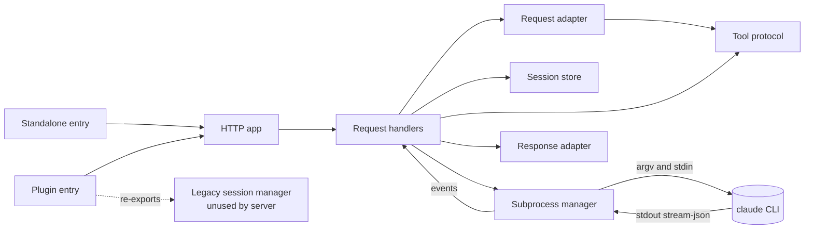

# Architecture

This is the map of claude-max-api-proxy: what it does, which component owns what, its public interfaces, and its sharp edges. Use it to decide which components a task touches.
Runtime flows are in [WORKFLOW.md](WORKFLOW.md), and the reasons for design choices are in [adrs/](adrs/README.md).
"Old `DESIGN.md`", "old `PROTOCOL.md`" and "old root `ARCHITECTURE.md`" are the original planning notes. They were removed after commit `2074263`, and their still-true content is here. Read them with `git show 2074263:DESIGN.md`.

## Purpose

**Problem.** A Claude subscription (Pro, Max or Team) does not work through the normal API, because its OAuth token is scope-restricted (old `DESIGN.md`). The proxy gets around this by running the official `claude` CLI, which holds the subscription login, and presenting its output as an OpenAI-compatible HTTP API.

**Users.** One person on one machine. Any OpenAI-compatible client that can reach `127.0.0.1:3456` works, including clients that send their own tools, as long as it addresses the server by a local name (see the Host check). OpenClaw was the original main client. There is no multi-user mode.

**Category.** A local OpenAI-compatible server in front of the Claude CLI, run as a plain language model. The CLI has no built-in tools, no MCP servers and no user or project configuration. A request is a chat: the client gets back the model's text. Tools are the client's: the proxy describes the client's tools to the model, and when the model asks for one, the proxy returns that as an OpenAI tool call. The proxy runs no tools itself.

**Non-obvious points**

- The fork was once tuned for OpenClaw. Its prompt adaptation (stripping OpenClaw sections, mapping OpenClaw tool names to Claude Code tools) has been removed. Client tools are now passed to the model as text in a proxy-built system prompt. See [run-cli-as-plain-llm-with-prompt-tool-calls](adrs/run-cli-as-plain-llm-with-prompt-tool-calls.md).
- Security effect: the CLI cannot run shell commands, edit files or fetch URLs on this machine, because it has no tools. The skip-permissions flag is still passed, but with no tools it guards nothing in practice.
- It was designed as a Clawdbot provider plugin (old `DESIGN.md`), but it runs as a standalone server, normally started by hand. An optional macOS LaunchAgent can start it automatically. The plugin entry still exists. The plist is not in this repo; see [WORKFLOW.md](WORKFLOW.md#running-as-a-macos-launchagent).
- Clawdbot's provider system handles authentication only, not API execution (old root `ARCHITECTURE.md`). So this proxy is a local endpoint that the provider's base URL points at, not a backend inside Clawdbot. See [local-openai-proxy-over-clawdbot-backend](adrs/local-openai-proxy-over-clawdbot-backend.md).
- The CLI keeps the credentials in the OS keychain. The proxy never reads them. Old `DESIGN.md` says `~/.claude/credentials.json`, which is stale.
- `total_cost_usd` in the CLI result is subscription usage, not API billing (old `PROTOCOL.md`). The proxy does not read it.

## Features

**API surface**

- `GET /health`, `GET /v1/models`, `POST /v1/chat/completions`. Any other path or method, OPTIONS included, returns a JSON 404.
- `stream: true` returns Server-Sent Events. Otherwise the response is one JSON body.
- Errors use the OpenAI error shape.

**Conversation handling**

- **System prompt.** Every request gets a system prompt built by the proxy, which replaces the CLI's default one. It opens with a base line saying the model has no tools of its own, no file system and no shell. Then comes the text of every `system` and `developer` message. When tools are active (see below), it adds a catalog of the client's tools, with each tool's name, description and parameter schema, and a protocol for calling them.
- **Prompt flattening.** The `messages` array becomes one text prompt, sent on stdin. User text is passed through. Assistant messages are wrapped in `<previous_response>`, with any tool calls they made written as tool-call blocks after their text. Tool messages become tool-result blocks that name the call they answer. System and developer text is not in the prompt; it is in the system prompt.
- **Session resume.** The client's `user` string maps to a CLI session ID. The first turn creates it with `--session-id`. Later turns use `--resume` and send only messages added since the last turn. Entries live in memory and expire after 6 hours idle. The system prompt is built and sent again on each turn.
- A request without `user` runs with `--no-session-persistence` and replays the full history each time.

**Client tool calling**

- **Active tools.** A request has active tools when its `tools` list is non-empty and `tool_choice` is not `"none"`. Only then are the tool catalog added to the system prompt and the reply text checked for tool calls. Otherwise the request is a plain chat, and any `tools` field is ignored.
- **Calls out of text.** The model is told to end its reply with one block per call. Each block is a tagged JSON object with a tool name and arguments, and the object ends at its matching closing brace, so a string argument may contain a literal closing tag. The proxy removes the blocks from the reply text and returns them as OpenAI `tool_calls`. Each call gets a generated ID (`call_` followed by 32 hex characters), and its arguments are a JSON string. The message content is the text left over, or null if nothing is left. The finish reason becomes `tool_calls`.
- **Fallback to text.** If any block is malformed, the proxy logs a warning and returns the whole reply as plain text with finish reason `stop`. A block is malformed if its JSON is invalid or not an object, its object never closes, no closing tag follows it, its arguments are neither an object nor a string holding valid JSON, or it names a tool the request did not declare. An opening tag with no object after it is ordinary text, not a block. The warning carries the request ID and up to 200 characters of the failing block. The whole reply goes back rather than only the good calls, so the client sees no tool call and can re-prompt (see the ADR). The client then sees the raw tool-call markup.
- **Advisory tool choice.** `tool_choice` set to required or to a named function adds a sentence to the system prompt asking for a call. Nothing checks that a call was made.
- **Results.** Client tool results come back as `tool` messages. The next prompt shows them as tool-result blocks, with the function name looked up from the matching earlier call.

**Streaming**

- Text deltas become `chat.completion.chunk` events as they arrive, unless the request has active tools. Then all text is held until the CLI run ends (see the streaming response section).
- A `\n\n` chunk separates text blocks when a new one starts after text was already sent.
- Usage is on the final chunk.
- A client disconnect kills the CLI, for non-streaming requests as well.

**Model selection**

- The model must be one of the supported IDs, or the request gets `404 model_not_found`. The prefixes `claude-code-cli/` and `claude-max/` are stripped first. The ID is passed unchanged to `claude --model`. The current list is in the [README](../README.md#supported-models).

**Operations**

- Port as the first argument, default 3456.
- `CLAUDE_BIN` selects the CLI binary.
- `DEBUG` logs requests and body prefixes. `DEBUG_SUBPROCESS` logs spawn arguments, prompt prefixes and stdout sizes. Separately, every chat-completion request writes one summary line when it finishes. No flag turns it on or off (see [WORKFLOW.md](WORKFLOW.md#dev-loop)).
- Startup checks that the CLI runs. The auth check is a no-op.
- Windows: resolves the bundled `claude.exe` behind the npm shim and kills the whole process tree. See [resolve-windows-exe-and-kill-process-tree](adrs/resolve-windows-exe-and-kill-process-tree.md).
- A 15-minute timeout per request. LaunchAgent setup is in [WORKFLOW.md](WORKFLOW.md#running-as-a-macos-launchagent).

**Accepted but ignored**

- `temperature`, `max_tokens`, `top_p`, `frequency_penalty`, `presence_penalty`, `parallel_tool_calls`: typed, never read.
- Image content blocks: only `text` and `input_text` blocks are kept. Images are dropped silently.

**Planned in the old design, never built**

- A process pool, a request queue and `maxConcurrent`. Every request spawns its own process with no limit.
- Plugin config options such as `timeout`, `maxConcurrent`, `sessionPersistence`, `debugMode` and `cwd`. The plugin's config schema is empty.
- Separate middleware, health and stream modules. Streaming logic lives in the request handlers.
- Native tool use through the CLI's own tool protocol. Client tools reach the model only as prompt text, and calls come back as text (see Client tool calling).
- Cost tracking, model routing, response caching and multi-user support.

## Vocabulary

| Group | Term | Meaning |
|---|---|---|
| OpenAI side | Chat completion | Non-streaming response, `object: "chat.completion"`. |
| OpenAI side | Chunk | One streaming event, `object: "chat.completion.chunk"`. |
| OpenAI side | SSE | Server-Sent Events: `data: <json>` lines followed by a blank line, on a held-open response. |
| OpenAI side | `[DONE]` | The literal line `data: [DONE]`, which ends a stream. |
| OpenAI side | `user` | Optional client string. It is the only per-conversation key the proxy has. |
| OpenAI side | Tool call | An entry in `tool_calls`: an ID, a function name and JSON-string arguments. The proxy produces these from text. |
| OpenAI side | `tool` message | A client message carrying a tool's output, matched to a call by `tool_call_id`. |
| CLI side | Print mode | `claude --print`: non-interactive, one prompt in, output out. |
| CLI side | stream-json | `--output-format stream-json`: one JSON object per stdout line. |
| CLI side | stream_event | A line that wraps a raw API streaming event. Present with `--include-partial-messages`. |
| CLI side | Content block | One piece of a message: `text` or `tool_use`. |
| CLI side | text_delta | A stream event delta carrying a piece of text. |
| CLI side | input_json_delta | A delta carrying partial JSON for a tool's input. Emitted, but nothing listens. |
| CLI side | Result message | The final `type: "result"` line: final text, usage and per-model usage. |
| CLI side | Session id | UUID naming a persisted CLI conversation. `--session-id` creates it and `--resume` continues it. |
| CLI side | Partial messages | `--include-partial-messages`. Adds `stream_event` lines alongside the full `assistant` lines. |
| Proxy internals | Session key | The `user` value, used as the key in the session store. |
| Proxy internals | messageCount | Length of `messages` at the last successful turn. Marks where the delta starts. |
| Proxy internals | Delta prompt | Messages after `messageCount` that are user or tool messages. Assistant messages are dropped. |
| Proxy internals | Supported model | One of the IDs the proxy accepts, passed unchanged to `--model`. |
| Proxy internals | Done chunk | The last streaming chunk, with the finish reason and usage. |
| Proxy internals | Block separator | The `\n\n` chunk inserted between text blocks. |
| Proxy internals | Active tools | A request with non-empty `tools` and a `tool_choice` other than `"none"`. Only these get the tool catalog and tool-call parsing. |
| Proxy internals | Tool-call block | The tagged JSON the model writes at the end of its reply to request a call. Parsed into a tool call. |
| Proxy internals | Tool-result block | The tagged wrapper that carries a client tool's output into the next prompt. |
| Host apps | OpenClaw | The original main client. Its prompt adaptation has been removed, but the example LaunchAgent label in the optional setup in [WORKFLOW.md](WORKFLOW.md#running-as-a-macos-launchagent) still says `openclaw`. |
| Host apps | Clawdbot | The host the original plugin targeted (old `DESIGN.md`). `clawdbot` is an optional peer dependency. This doc does not say whether Clawdbot and OpenClaw are the same project. Treat them as separate names. |

**How these connect**

- `user` → session key → CLI session ID (stored, or a new UUID) → `--session-id` or `--resume`.
- `stream_event` text_delta → SSE chunk, or held text when tools are active.
- Result message → tool calls (when active tools find block-form calls) → done chunk and `[DONE]` when streaming. It becomes the whole response body when not streaming.

**Easily confused**

- The **legacy session manager** is file-backed (`~/.claude-code-cli-sessions.json`), keyed by a Clawdbot conversation ID, with a 24-hour TTL. The library entry exports it, but the server never uses it.
- The **session store** is the one the server uses. It is in memory, keyed by `user`, with a 6-hour TTL.
- A **tool call** in the OpenAI sense is not a CLI `tool_use` block. The CLI never makes one here, because it has no tools. The proxy finds the call in the model's text.

## Components



This table is the one place that maps components to files. The rest of the docs use the component names.

| Component | File | Responsibility |
|---|---|---|
| Standalone entry | `src/server/standalone.ts` | What runs. Parses the port, runs the startup checks, starts the server, handles SIGINT and SIGTERM. |
| Plugin entry | `src/index.ts` | Clawdbot provider plugin, the models it advertises, and the library exports. |
| HTTP app | `src/server/index.ts` | Express app: Host check, body parsing, debug log, routing, 404, error handler, listen and stop. |
| Request handlers | `src/server/routes.ts` | Chat completions (validation, model check, session resolution, streaming and non-streaming paths, and tool-call handling when tools are active), models, health. Also decides when each chat-completion request has finished, for the summary line. |
| Request log | `src/server/request-log.ts` | Formats the one-line summary written for each chat-completion request, from fields the request handlers collect. Formatting only. |
| Request adapter | `src/adapter/openai-to-cli.ts` | The supported-model list and its check, prompt flattening for user, assistant and tool messages, and the delta prompt. |
| Tool protocol | `src/adapter/tools.ts` | Builds the system prompt (base line, system and developer text, tool catalog and calling protocol). Renders tool calls and tool results as text for the prompt. Parses tool-call blocks out of reply text. |
| Response adapter | `src/adapter/cli-to-openai.ts` | Builds the non-streaming body (with `tool_calls` when present) and the streaming chunks: text deltas, the tool-call chunk and the done chunk. |
| Subprocess manager | `src/subprocess/manager.ts` | Finds the CLI binary, builds arguments (the no-tools flags and the system prompt), spawns, parses stdout into events, times out and kills. Holds the startup checks. |
| Session store | `src/subprocess/session-store.ts` | In-memory `user` to CLI session map with TTL. |
| Legacy session manager | `src/session/manager.ts` | Old file-backed session map. Not used by the server. |
| Types | `src/types/` | OpenAI request and response shapes (including tools and tool calls), CLI stream-json message shapes and type guards. |
| Tests | `src/**/*.test.ts` | An end-to-end test against the real CLI, Windows-only process-tree tests, a missing-binary spawn test, and unit tests for the model check. See [WORKFLOW.md](WORKFLOW.md#tests). |

**Entry points**

- The **standalone entry** is what runs. The build output is `dist/server/standalone.js`. It is the `bin` target and the `npm start` script.
- The **plugin entry** registers provider `claude-code-cli` with aliases `claude-cli` and `claude-max`. Its auth flow asks for a port, starts the server and returns a base URL of `http://127.0.0.1:<port>/v1`. It also registers the `claude-cli:start`, `claude-cli:stop` and `claude-cli:status` commands.
- **Import side effects.** Importing the library loads the legacy session manager. At import time that module reads `~/.claude-code-cli-sessions.json` and starts an hourly timer that is not `unref`'d, which keeps a process alive. Importing the library is therefore not free. Do not add more side effects to the plugin entry.

**Model lists live in 2 places**

- The **supported-model list** in the request adapter. It drives validation, `GET /v1/models` and the 404 message. The e2e test compares `/v1/models` against it, so the test needs no edit when the list changes.
- The **advertised list** in the plugin entry: the few models the plugin's config patch offers OpenClaw. It is not used for validation.

Adding a model means adding it to the supported-model list and checking the ID against the CLI. Change the advertised list only if the plugin should offer it.

**Where to start reading**

1. The chat completions handler: validation (messages, then model), then session resolution, then the streaming or non-streaming path.
2. Session resolution, then the request adapter's full and delta prompt builders and the tool protocol's system prompt.
3. The subprocess manager: start, argument building, and stdout line parsing.
4. The event listeners in the streaming path, and the tool-call handling after the result.

## Interfaces / APIs

### Inbound HTTP (127.0.0.1:3456)

| Method and path | Behaviour |
|---|---|
| `GET /health` | `200 {"status":"ok","provider":"claude-code-cli","timestamp":"…"}` |
| `GET /v1/models` | `200 {"object":"list","data":[{"id","object":"model","owned_by":"anthropic","created"}]}` |
| `POST /v1/chat/completions` | Chat handler, below. |
| anything else | `404 {"error":{"message":"Not found","type":"invalid_request_error","code":"not_found"}}` |

Responses carry no CORS headers. A request whose Host is not a local name (localhost, `127.0.0.1`, `::1`, or the bind host) gets `403 {"error":{"message":"Forbidden host","type":"invalid_request_error","code":"forbidden_host"}}`. This blocks drive-by browser use and DNS rebinding. See [localhost-only-no-auth-host-allowlist](adrs/localhost-only-no-auth-host-allowlist.md).

**Request fields actually used**

- `messages`: required. Must be a non-empty array, or the response is `400` with code `invalid_messages`.
  - `system` and `developer` messages: their text goes into the system prompt.
  - `user` messages: their text goes into the prompt.
  - `assistant` messages: their text and any `tool_calls` go into the prompt on a full-history turn. Resumed turns drop them.
  - `tool` messages: their content goes into the prompt as a tool result, with the call's ID and, when the matching call is in the history, its function name.
- `tools`: function tools the client offers. Non-empty, with `tool_choice` not `"none"`, makes the request active-tools: the catalog is added to the system prompt and the reply is checked for tool calls. Otherwise it is ignored.
- `tool_choice`: `"none"` turns tools off for the request, even when `tools` is set. The default (absent or `"auto"`) leaves the model free. `"required"` and the named-function form add a sentence to the system prompt asking for a call. The proxy does not enforce it.
- `model`: must be a supported ID, optionally prefixed with `claude-code-cli/` or `claude-max/`. Otherwise `404 model_not_found`. The ID is passed unchanged to the CLI.
- `stream`: streaming only when `=== true`.
- `user`: session key.
- Everything else is ignored, including the fields listed under "Accepted but ignored".

Only `Content-Type: application/json` is parsed. Any other content type leaves `messages` undefined, so the response is the 400 above. The body limit is 10 MB.

**Non-streaming response**

```json
{"id":"chatcmpl-<24 hex>","object":"chat.completion","created":1767000000,"model":"claude-sonnet-5-5",
 "choices":[{"index":0,"message":{"role":"assistant","content":"…"},"finish_reason":"stop"}],
 "usage":{"prompt_tokens":2054,"completion_tokens":13,"total_tokens":2067,"prompt_tokens_details":{"cached_tokens":2041},"completion_tokens_details":{"reasoning_tokens":0}}}
```

`model` is the requested ID with any provider prefix removed. There is no `X-Request-Id` header on this path. `usage` is always present here, with zero counts when the CLI reported none. Its fields map from the CLI result as follows: `prompt_tokens` is fresh input plus cache reads and cache writes, because Anthropic's input count leaves out cached tokens; `completion_tokens` is output tokens; `prompt_tokens_details.cached_tokens` is cache reads; and `completion_tokens_details.reasoning_tokens` is thinking tokens, which are already inside `completion_tokens`.

When active tools find tool-call blocks, the message carries a `tool_calls` array, `content` is the leftover text or null, and `finish_reason` is `tool_calls`. Each call has an ID of `call_` followed by 32 hex characters, type `function`, and arguments as a JSON string. In every other case there is no `tool_calls` field and the finish reason is `stop`, including when a block was malformed and the whole text was returned.

**Streaming response**

```
HTTP header: Content-Type: text/event-stream, X-Request-Id: <24 hex>

:ok

data: {"id":"chatcmpl-…","object":"chat.completion.chunk","created":…,"model":"…","choices":[{"index":0,"delta":{"role":"assistant","content":"Hel"},"finish_reason":null}]}

data: {…,"choices":[{"index":0,"delta":{"content":"lo"},"finish_reason":null}]}

data: {…,"choices":[{"index":0,"delta":{},"finish_reason":"stop"}],"usage":{"prompt_tokens":2054,"completion_tokens":13,"total_tokens":2067,"prompt_tokens_details":{"cached_tokens":2041},"completion_tokens_details":{"reasoning_tokens":0}}}

data: [DONE]
```

The first chunk has `role`. Every chunk, including the done chunk, carries the requested ID (prefix removed) as `model`. The usage block has the same fields as the non-streaming body. It appears only if the CLI result had usage. `:ok` is the first line, sent before the subprocess starts.

With active tools, no text reaches the client until the CLI run ends. After that the client gets, in order: a content chunk with the leftover text, if there is any; one chunk whose delta carries `tool_calls`, each with its index, ID, type and function; and the done chunk with finish reason `tool_calls`, then usage and `[DONE]`. The `role` field sits on whichever of those two chunks is first. If tool-call parsing fails, the whole text goes out as one content chunk and the done chunk has finish reason `stop`.

**Errors**

- Validation: `400 {"error":{"message","type":"invalid_request_error","code":"invalid_messages"}}`.
- Missing, non-string or unsupported `model`: `404 {"error":{"message","type":"invalid_request_error","param":"model","code":"model_not_found"}}`. The message lists the supported IDs. Checked after the messages check, so an empty `messages` gets the 400.
- Anything thrown before streaming starts: `500`, `type: "server_error"`, `code: null`.
- Non-streaming CLI error, timeout, early exit or failed spawn: `500 server_error`. A CLI result with `is_error` true is the same, with the CLI's message.
- Malformed JSON, or a body over 10 MB: `500 server_error` with the parser message. These are not 400 or 413.
- Streaming, error during the run or a failed spawn: a `data: {"error":{…}}` line, then the stream ends with no `[DONE]`.
- Streaming, CLI result with `is_error` true: the same error line with the CLI's message, then `[DONE]`, then the stream ends.
- Streaming, CLI exits with no result: an error line, then `[DONE]`.

### Config surface

| Setting | Default | Notes |
|---|---|---|
| Port (first CLI argument) | 3456 | The only CLI argument. The plugin asks for it during setup. Not an env var. |
| Host | `127.0.0.1` | Library callers of the server start function can pass a host. Nothing in the repo does, and there is no CLI or env option. Its value is also accepted in the Host check. |
| `DEBUG` | off | Logs request lines and body prefixes (200 and 300 characters). |
| `DEBUG_SUBPROCESS` | off | Logs CLI arguments (which include the system prompt), a 200-character prompt prefix, stdout sizes and stderr. |
| Request summary line | always on | One line per chat-completion request when it finishes. No setting turns it off. Format in [WORKFLOW.md](WORKFLOW.md#dev-loop). |
| `CLAUDE_BIN` | `claude` | Not cached, so changes take effect at the next spawn. |
| Request timeout | 15 min | The subprocess accepts a custom timeout, but no caller passes one. |
| Session TTL | 6 h idle | |
| Session prune | every 30 min | The timer is `unref`'d. |
| Body limit | 10 MB | |
| `CLAUDECODE` | stripped | Removed from the CLI's environment. |

None of these can be set per request.

### Outbound to the CLI

**Spawn.** One child per request, run in a fixed folder under the OS temp directory (created if missing) rather than the proxy's own directory, so the CLI does not load the repo's project context. The child gets the proxy's environment minus `CLAUDECODE`, piped stdio, and no shell. A shell is used only by the Windows shim fallback.

**Arguments**, in order:

```
claude --print --dangerously-skip-permissions --output-format stream-json --verbose
       --include-partial-messages --model <full model ID>
       --tools "" --strict-mcp-config --safe-mode
       --system-prompt <proxy-built system prompt>
       <one session flag, below>
```

- `--tools ""` turns off all built-in tools.
- `--strict-mcp-config` ignores MCP servers from the CLI's settings.
- `--safe-mode` skips the CLI's CLAUDE.md memory, skills and hooks.
- `--system-prompt` replaces Claude Code's default system prompt. The system prompt is omitted only if it is empty, which the proxy never produces.
- `--dangerously-skip-permissions` is still passed. With no tools there is nothing to approve.

The session flag has three branches:

- Stored session for this `user` → `--resume <id>`. Existing session, delta prompt.
- `user` with no stored session → `--session-id <new UUID>`. First turn for that `user`.
- No `user` → `--no-session-persistence`.

**Stdin.** The prompt is written as plain text, then stdin is closed. There is no `--input-format` flag. The `user_message` JSON idea in old `PROTOCOL.md` was never used. The system prompt is not on stdin; see the sharp edges.

**Stdout.** Newline-delimited JSON, split into lines and parsed one by one. Non-JSON lines are emitted as `raw`, and nothing listens to them. Stderr is logged only under `DEBUG_SUBPROCESS` and never fails a request. A non-zero exit with no result is an error.

### CLI output message types

"Used by proxy" reflects what the subprocess manager emits and which events the request handlers listen to.

| Message (`type` / `subtype` or `event.type`) | Used by proxy? |
|---|---|
| `system` / `init` | No. Only the generic `message` event carries it, and nothing listens. |
| `system` / `hook_started`, `hook_response` | No. |
| `assistant` | No. Emitted, but nothing listens. Its `tool_use` blocks are not read, and the CLI produces none while it has no tools. |
| `result` | Yes. Streaming: usage, tool-call handling, done chunk, session save. Non-streaming: the whole body, with tool-call handling. `is_error` true makes the result an error (see the error shapes above). `subtype` is used only in the fallback error message. |
| `stream_event` / `content_block_delta` with `text_delta` | Yes. Becomes an SSE chunk, or held text when tools are active. |
| `stream_event` / `content_block_start` with `text` | Yes. Triggers the block separator. |
| `stream_event` / `content_block_start` with `tool_use` | Emitted as `tool_use_start`. Nothing listens. Does not occur while the CLI has no tools. |
| `stream_event` / `content_block_delta` with `input_json_delta` | Emitted. Nothing listens. Does not occur while the CLI has no tools. |
| `stream_event` / `content_block_stop` | Emitted. Nothing listens. |
| `stream_event` / `message_start`, `message_delta`, `message_stop` | No. |
| Any other `type` | No. Emitted only as `message`. |

Shape examples, trimmed from old `PROTOCOL.md` (captured output, not a spec):

```json
{"type":"stream_event","event":{"type":"content_block_delta","index":0,"delta":{"type":"text_delta","text":"Hel"}},"session_id":"72db4887-…","uuid":"…"}
```

```json
{"type":"result","subtype":"success","is_error":false,"duration_ms":3613,"num_turns":1,"result":"The final text response","session_id":"72db4887-…","total_cost_usd":0.159,"usage":{"input_tokens":2,"output_tokens":13,"cache_creation_input_tokens":42255,"cache_read_input_tokens":0},"modelUsage":{"claude-sonnet-4-5-20250929":{"inputTokens":2,"outputTokens":13,"costUSD":0.158}}}
```

## Task → components

| Task | Start here | Also touch | ADR |
|---|---|---|---|
| Add or rename a model | Supported-model list (request adapter) | The plugin's advertised list, only if the plugin should offer it. The models endpoint and the e2e test follow the list. Check the ID against the CLI. | [pass-full-model-ids-to-cli](adrs/pass-full-model-ids-to-cli.md) |
| Change prompt formatting | Prompt flattening (request adapter) | Content-block text extraction; OpenAI content types; the delta prompt filter | [flatten-messages-into-one-prompt](adrs/flatten-messages-into-one-prompt.md) |
| Change the system prompt or what goes in it | The system prompt builder (tool protocol) | Argument building (subprocess manager), which passes it; the system and developer message handling (request adapter) | [run-cli-as-plain-llm-with-prompt-tool-calls](adrs/run-cli-as-plain-llm-with-prompt-tool-calls.md) |
| Change tool calling: client tools, `tool_choice`, tool-call replies or tool results | Tool protocol (catalog, calling protocol, call parser) | Tool rendering in prompt flattening (request adapter); tool-call chunk and `tool_calls` body (response adapter); the active-tools handling in both response paths (request handlers) | [run-cli-as-plain-llm-with-prompt-tool-calls](adrs/run-cli-as-plain-llm-with-prompt-tool-calls.md) |
| Support images | Content-block text extraction (request adapter) | OpenAI content types; the prompt is text-only on stdin (subprocess manager) | [flatten-messages-into-one-prompt](adrs/flatten-messages-into-one-prompt.md) |
| Change CLI flags or permissions | Argument building (subprocess manager) | The system prompt passed to it; the subprocess manager tests | [skip-cli-permission-prompts](adrs/skip-cli-permission-prompts.md), [run-cli-as-plain-llm-with-prompt-tool-calls](adrs/run-cli-as-plain-llm-with-prompt-tool-calls.md) |
| Streaming output bugs | Streaming path (request handlers) | Stdout line parsing (subprocess manager); `stream_event` type guards; the block separator; the held text when tools are active | [stream-text-deltas-as-sse](adrs/stream-text-deltas-as-sse.md) |
| Non-streaming response shape or usage | Response adapter | Non-streaming path (request handlers); CLI result usage types | None (see sharp edges) |
| Multi-turn or session bugs | Session resolution (request handlers) | Session store; delta prompt (request adapter); every place that saves or clears a session on result, error or close | [resume-cli-sessions-keyed-by-user](adrs/resume-cli-sessions-keyed-by-user.md) |
| Auth, CORS or security hardening | Host check and error handler (HTTP app); the auth check (subprocess manager) | Bind host; the permissions flag; [security review](security-review/bad-coding-practices.md) | [localhost-only-no-auth-host-allowlist](adrs/localhost-only-no-auth-host-allowlist.md) |
| Timeouts, kill or orphaned processes | Timeout and kill (subprocess manager) | Process-tree kill; the disconnect handlers in both response paths | [resolve-windows-exe-and-kill-process-tree](adrs/resolve-windows-exe-and-kill-process-tree.md) |
| Windows issues | CLI binary lookup (subprocess manager) | Process-tree kill; spawn options | [resolve-windows-exe-and-kill-process-tree](adrs/resolve-windows-exe-and-kill-process-tree.md) |
| Host check (403), CORS, or local-only access | HTTP app (Host check and bind host) | The Host setting (config surface) | [localhost-only-no-auth-host-allowlist](adrs/localhost-only-no-auth-host-allowlist.md) |
| CLI `is_error` results | Response adapter (error message) and request handlers (both response paths) | Session save, which still happens on such a result | None |
| Request validation or body parse errors | Validation in the chat completions handler | Body parser and error handler (HTTP app) | None |
| Startup checks | Standalone entry | CLI and auth checks (subprocess manager) | None |
| Clawdbot plugin | Plugin entry | Legacy session manager | [local-openai-proxy-over-clawdbot-backend](adrs/local-openai-proxy-over-clawdbot-backend.md) |
| Spawn options, cwd or env | Spawn (subprocess manager) | The `CLAUDECODE` filter | [spawn-one-cli-process-per-request](adrs/spawn-one-cli-process-per-request.md) |
| Logging | The summary line: request log (formatting) and request handlers (when a request finishes); the tool-call warning (tool protocol) | Usage mapping (response adapter); `DEBUG` (HTTP app) and `DEBUG_SUBPROCESS` (subprocess manager), which add detail only when set. Logs use `console` throughout. | None |

## Sharp edges

Items marked **inferred** come from reading the code. They have not been run.

- **A JSON `null` body crashes the process.** `JSON.parse("null")` makes the body `null`. The handler reads `body.stream` before its `try` block. The async handler rejects, and Express 4 does not catch that. Node exits on an unhandled rejection by default. Also in the [security review](security-review/bad-coding-practices.md).
- **Streaming and non-streaming can return different text.** Streaming forwards every text delta, with separators between blocks. Non-streaming returns only the result message's final text. They can differ when the CLI emits several text blocks. **Inferred.**
- **Text-parsed tool calls fall back to plain text.** If any tool-call block is malformed (see Fallback to text), the whole reply goes back as text with finish reason `stop`. Only a server log line records the failure, so the client sees the raw markup and may not realise a call was intended. This is deliberate: keeping only the valid calls could lose work silently.
- **Tool choice is advisory.** `required` and the named-function choice only add a sentence to the system prompt. A reply with no block is a normal text reply, and nothing retries it.
- **Streaming with active tools is buffered.** The client sees nothing until the whole CLI run ends, so a long run looks like a stall. Text then arrives as one chunk, not as a stream.
- **Tool call IDs are not kept.** The proxy makes new IDs for each reply and stores none. A later tool result is matched by the ID the client sends. Its name is looked up from the request history, and it is left out when the call is not there.
- **The system prompt is a command-line argument.** Stdin is used for the user prompt to avoid argument size limits, but the system prompt, including a large tool catalog, goes on the command line. It can hit the OS argument limit. **Inferred, not tested.**
- **The CLI still injects an account-context block.** The logged-in user's email goes into the model's context, and the no-tools flags do not remove it. Skills and plugins still appear in the CLI's init metadata, although the model reports none in its context.
- **A shrunken history floods the resumed session.** If `messages` gets shorter than the stored `messageCount`, the delta is empty, and the full history is sent into the resumed session. Edits that keep the length the same are not sent, because only the tail is. **Inferred.**
- **Two concurrent requests with the same `user` share one session.** Nothing serializes turns, and both `--resume` the same ID. Behaviour under concurrent `--resume` is untested.
- **The session map is lost on restart.** It lives in process memory. The next turn starts a new CLI session with the full history. The CLI's own transcripts stay on disk.
- **Aborted requests log no usage.** A request whose client disconnects is logged as `aborted` at the disconnect, with no token counts, so the usage of a run that was killed is not recorded.
- **On macOS and Linux, kill signals only the direct child.** Descendants are not reached. Timeouts and client disconnects both use this path. Windows uses `taskkill /T`.
- **Listener exceptions are swallowed.** Stdout parsing wraps event emission in the same `try` as the JSON parse. A throw in a request-handler listener becomes a `raw` event that nothing listens to, so the failure is silent. **Inferred.**
- **The auth check always passes.** A logged-out CLI shows up on the first request, not at startup.
- **Malformed JSON and oversized bodies return 500.** They go to the generic error handler, so the client gets `500 server_error`, not 400 or 413.
- **Dead code.** The response adapter has an unused per-message chunk converter. The CLI types have an unused init-message guard. The subprocess manager has an unused is-running check and an unused typed events interface. Its tool events (`tool_use_start`, `input_json_delta`, `content_block_stop`) have no listeners and do not fire while the CLI has no tools.
- **Stale naming.** The session store's header comment calls the key a "Hermes conversation key". It is just the request's `user` field. The legacy session manager's header describes Clawdbot IDs, which the server does not use.
