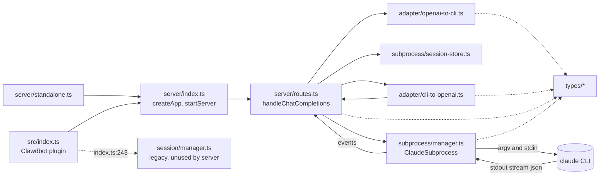

# Architecture

This is the code map for claude-max-api-proxy. Use it to find the files and functions to touch for a task, and to see which parts are live, dead or only planned.
Line references are as of commit `2074263`; re-check them if the code has moved. Runtime flows are in [WORKFLOW.md](WORKFLOW.md), and the reasons for design choices are in [adrs/](adrs/README.md).
"Old `DESIGN.md`", "old `PROTOCOL.md`" and "old root `ARCHITECTURE.md`" are the original planning notes. They were removed after commit `2074263`, and their still-true content is here. Read them with `git show 2074263:DESIGN.md`.

## Purpose

**Problem.** A Claude subscription (Pro, Max or Team) does not work through the normal API, because its OAuth token is scope-restricted (old `DESIGN.md`). The proxy gets around this by running the official `claude` CLI, which holds the subscription login, and presenting its output as an OpenAI-compatible HTTP API.

**Users.** One person on one machine. The main client is OpenClaw. Any OpenAI-compatible client that can reach `127.0.0.1:3456` also works. There is no multi-user mode.

**Category.** A local OpenAI-compatible server in front of a CLI agent. It is not a model gateway. The CLI is a full agent with its own tools (Bash, Read, Edit, WebFetch) and runs them without asking (`src/subprocess/manager.ts:298`). A request is therefore a task for Claude Code. The client gets back the agent's final text. Tool calls never reach the client, and the proxy runs no tools itself.

**Non-obvious points**

- It was designed as a Clawdbot provider plugin (`src/index.ts`, old `DESIGN.md`), but it runs as a standalone server. The plugin's `register()` still exists (`src/index.ts:76`). The running service is `src/server/standalone.ts`, started under a macOS LaunchAgent (per `CLAUDE.md`; the plist is not in this repo).
- Clawdbot's provider system handles authentication only, not API execution (old root `ARCHITECTURE.md`). So this proxy is a local endpoint that the provider's `baseUrl` points at (`src/index.ts:140`), not a backend inside Clawdbot. See [local-openai-proxy-over-clawdbot-backend](adrs/local-openai-proxy-over-clawdbot-backend.md).
- The fork is tuned for OpenClaw. OpenClaw system-prompt sections are stripped (`src/adapter/openai-to-cli.ts:80-100`), and a tool-name mapping prompt is always appended (`src/subprocess/manager.ts:55-92, 305-306`), including for non-OpenClaw clients.
- The CLI keeps the credentials in the OS keychain (`src/subprocess/manager.ts:454-456`). The proxy never reads them. Old `DESIGN.md:42` says `~/.claude/credentials.json`, which is stale.
- `total_cost_usd` in the CLI result is subscription usage, not API billing (old `PROTOCOL.md`). The proxy does not read it.

## Features

**API surface**

- `GET /health`, `GET /v1/models`, `POST /v1/chat/completions`, and `OPTIONS *`. Any other path returns a JSON 404 (`src/server/index.ts:74-87`).
- `stream: true` returns Server-Sent Events. Otherwise the response is one JSON body.
- Errors use the OpenAI error shape.

**Conversation handling**

- **Prompt flattening.** The whole `messages` array becomes one text prompt. System messages are wrapped in `<system>`, assistant messages in `<previous_response>`, and user text is passed through (`src/adapter/openai-to-cli.ts:108-135`).
- **Session resume.** The client's `user` string maps to a CLI session ID. The first turn creates it with `--session-id`. Later turns use `--resume` and send only messages added since the last turn (`src/server/routes.ts:30-53`, `src/adapter/openai-to-cli.ts:154-169`). Entries live in memory and expire after 6 hours idle.
- A request without `user` runs with `--no-session-persistence` and replays the full history each time (`src/subprocess/manager.ts:317-321`).

**Streaming**

- Text deltas become `chat.completion.chunk` events as they arrive (`src/server/routes.ts:182-204`).
- A `\n\n` chunk separates text blocks when a new one starts after text was already sent (`src/server/routes.ts:160-179`).
- Usage is on the final chunk (`src/server/routes.ts:290-296`).
- A client disconnect kills the CLI (`src/server/routes.ts:152-158`).

**OpenClaw adaptation**

- Strips `## Tooling`, `## Tool Call Style`, `## OpenClaw CLI Quick Reference` and `## OpenClaw Self-Update` from system messages (`src/adapter/openai-to-cli.ts:80-100`).
- Appends a map from OpenClaw tool names to Claude Code tools, such as `exec` to `Bash` and `memory_search` to `openclaw memory search` (`src/subprocess/manager.ts:55-92`).

**Model selection**

- Client model IDs collapse to the CLI aliases `opus`, `sonnet` and `haiku` (`src/adapter/openai-to-cli.ts:15-52`). The prefixes `claude-code-cli/` and `claude-max/` are stripped first.

**Operations**

- Port as the first argument, default 3456 (`src/server/standalone.ts:21`).
- `CLAUDE_BIN` selects the CLI binary (`src/subprocess/manager.ts:110-113`).
- `DEBUG` logs requests and body prefixes (`src/server/index.ts:29, 37, 54`). `DEBUG_SUBPROCESS` logs spawn arguments, prompt prefixes and stdout sizes (`src/subprocess/manager.ts:206-273`).
- Startup checks that the CLI runs (`verifyClaude`). The auth check is a no-op (`verifyAuth`).
- Windows: resolves the bundled `claude.exe` behind the npm shim and kills the whole process tree. See [resolve-windows-exe-and-kill-process-tree](adrs/resolve-windows-exe-and-kill-process-tree.md).
- A 15-minute timeout per request (`src/subprocess/manager.ts:48`). LaunchAgent setup is in [WORKFLOW.md](WORKFLOW.md#running-as-a-macos-launchagent).

**Accepted but ignored**

- `temperature`, `max_tokens`, `top_p`, `frequency_penalty`, `presence_penalty`: typed in `src/types/openai.ts:20-24`, never read.
- `tools` and `tool_choice`: not typed and not read. Tool-call forwarding is commented out (`src/server/routes.ts:206-275, 367-383`).
- Image content blocks: `extractText` keeps only `text` and `input_text` blocks (`src/adapter/openai-to-cli.ts:60-71`). Images are dropped silently.
- Messages with role `tool`: no `case` in the switch (`src/adapter/openai-to-cli.ts:115-131`), so they are dropped silently. The type does not include `tool` either (`src/types/openai.ts:12`).

**Planned in the old design, never built** (none of these exist in `src/`)

- A process pool, a request queue and `maxConcurrent` (old `DESIGN.md:62, 746, 761`). Every request spawns its own process with no limit.
- Plugin config options such as `timeout`, `maxConcurrent`, `sessionPersistence`, `debugMode` and `cwd` (old `DESIGN.md:757-766`). The plugin's config schema is empty (`src/index.ts:56-64`).
- `middleware.ts`, `health.ts` and `stream.ts` modules (old `DESIGN.md:59, 63, 66`). Streaming logic lives in `routes.ts`.
- Tool bridging, cost tracking, model routing, response caching and multi-user support (old `DESIGN.md:801-807`).

## Vocabulary

| Group | Term | Meaning |
|---|---|---|
| OpenAI side | Chat completion | Non-streaming response, `object: "chat.completion"` (`src/types/openai.ts:57-68`). |
| OpenAI side | Chunk | One streaming event, `object: "chat.completion.chunk"` (`src/types/openai.ts:82-93`). |
| OpenAI side | SSE | Server-Sent Events: `data: <json>` lines followed by a blank line, on a held-open response. |
| OpenAI side | `[DONE]` | The literal line `data: [DONE]`, which ends a stream. |
| OpenAI side | `user` | Optional client string. It is the only per-conversation key the proxy has (`src/types/openai.ts:25`, `src/server/routes.ts:39`). |
| CLI side | Print mode | `claude --print`: non-interactive, one prompt in, output out (`src/subprocess/manager.ts:297`). |
| CLI side | stream-json | `--output-format stream-json`: one JSON object per stdout line (`src/subprocess/manager.ts:299-301`). |
| CLI side | stream_event | A line that wraps a raw API streaming event. Present with `--include-partial-messages` (`src/types/claude-cli.ts:102-136`). |
| CLI side | Content block | One piece of a message: `text` or `tool_use` (`src/types/claude-cli.ts:39-49`). |
| CLI side | text_delta | A stream event delta carrying a piece of text (`src/types/claude-cli.ts:110-112`). |
| CLI side | input_json_delta | A delta carrying partial JSON for a tool's input. Read but not forwarded. |
| CLI side | Result message | The final `type: "result"` line: final text, usage and per-model usage (`src/types/claude-cli.ts:73-94`). |
| CLI side | Session id | UUID naming a persisted CLI conversation. `--session-id` creates it and `--resume` continues it. |
| CLI side | Partial messages | `--include-partial-messages`. Adds `stream_event` lines alongside the full `assistant` lines. |
| Proxy internals | Session key | The `user` value, used as the key in the session store (`src/subprocess/session-store.ts:17`). |
| Proxy internals | messageCount | Length of `messages` at the last successful turn. Marks where the delta starts (`src/server/routes.ts:84`). |
| Proxy internals | Delta prompt | Messages after `messageCount`, minus assistant messages (`src/adapter/openai-to-cli.ts:154-169`). |
| Proxy internals | CliInput | `{ prompt, model, sessionId }`, built per request (`src/adapter/openai-to-cli.ts:9-13`). |
| Proxy internals | Model alias | `opus`, `sonnet` or `haiku`, passed to `--model` (`src/adapter/openai-to-cli.ts:7`). |
| Proxy internals | Done chunk | The last streaming chunk, with `finish_reason: "stop"` and usage (`src/adapter/cli-to-openai.ts:49-63`). |
| Proxy internals | Block separator | The `\n\n` chunk inserted between text blocks (`src/server/routes.ts:160-179`). |
| Host apps | OpenClaw | The agent app this fork is tuned for. Its prompts are adapted (`src/adapter/openai-to-cli.ts:80-100`, `src/subprocess/manager.ts:55-92`). It is the main client. |
| Host apps | Clawdbot | The host the original plugin targeted (`src/index.ts`, old `DESIGN.md`). `clawdbot` is an optional peer dependency (`package.json`). This doc does not say whether Clawdbot and OpenClaw are the same project. Treat them as separate names. |

**How these connect**

- `user` → session key (`routes.ts:39`) → CLI session ID (stored at `routes.ts:44`, or a new UUID at `routes.ts:50`) → `--session-id` or `--resume` (`manager.ts:310-316`).
- `stream_event` text_delta → SSE chunk (`routes.ts:182-204`).
- Result message → done chunk and `[DONE]` when streaming (`routes.ts:282-303`). It becomes the whole response body when not streaming (`routes.ts:385-387`, `cli-to-openai.ts:68-106`).

**Easily confused**

- `src/session/manager.ts` is **legacy**. It is file-backed (`~/.claude-code-cli-sessions.json`), keyed by a Clawdbot conversation ID, with a 24-hour TTL. It is exported from the library entry point (`src/index.ts:243`), but the server never imports it.
- `src/subprocess/session-store.ts` is **the one the server uses**. It is in memory, keyed by `user`, with a 6-hour TTL.

## Architecture



**Module table**

| File | Lines | Responsibility | Key symbols (line) |
|---|---|---|---|
| `src/server/standalone.ts` | 73 | Runs the server. Checks the CLI and auth, then starts. | `main` 16; port 21; checks 28-44; start 48; shutdown 60-67 |
| `src/index.ts` | 243 | Clawdbot plugin object and library exports. | `register` 76; `AVAILABLE_MODELS` 18-37; `buildModelDefinition` 42; exports 241-243 |
| `src/server/index.ts` | 162 | Express app, middleware, CORS, error handling, server lifecycle. | `createApp` 21; body parse 25-50; CORS 61-66; OPTIONS 69-71; routes 74-76; 404 79-87; error handler 90-99; `startServer` 107; `stopServer` 139; `getServer` 160 |
| `src/server/routes.ts` | 487 | HTTP handlers. Validation, session resolution, streaming and non-streaming response paths. | `resolveCliInput` 30-53; `handleChatCompletions` 60-105; `handleStreamingResponse` 122-353; `handleNonStreamingResponse` 358-445; `handleModels` 452; `handleHealth` 481 |
| `src/adapter/openai-to-cli.ts` | 169 | OpenAI request to CLI input. Model mapping, prompt flattening, delta prompt. | `MODEL_MAP` 15-33; `extractModel` 38-52; `extractText` 60-71; `stripOpenClawTooling` 80-100; `messagesToPrompt` 108-135; `openaiToCli` 140-146; `openaiToCliDelta` 154-169 |
| `src/adapter/cli-to-openai.ts` | 118 | CLI output to OpenAI shapes. | `extractTextContent` 11; `cliToOpenaiChunk` 21 (unused); `createDoneChunk` 49; `cliResultToOpenai` 68-106; `normalizeModelName` 112-118 |
| `src/subprocess/manager.ts` | 464 | Spawns and reads the CLI. Arguments, env, stdout parsing, timeout and kill. | `DEFAULT_TIMEOUT` 48; `OPENCLAW_TOOL_MAPPING_PROMPT` 55-92; `resolveClaudeBin` 109-146; `killProcessTree` 157-192; `start` 203-290; `buildArgs` 295-324; `processBuffer` 329-371; `kill` 386-391; `armTimeout` 397-407; `verifyClaude` 420-449; `verifyAuth` 458-464 |
| `src/subprocess/session-store.ts` | 54 | In-memory `user` to CLI session map with TTL. | TTL 14; prune 15-26; `getSession` 34-42; `setSession` 44-50; `clearSession` 52-54 |
| `src/session/manager.ts` | 165 | Legacy file-backed session map. Not used by the server. | `SESSION_FILE` 20-23; `load` 35-49; singleton 155; import-time side effects 157-165 |
| `src/types/openai.ts` | 113 | OpenAI request, response, chunk and error types. | request 16-26; message 11-14; response 57-68; chunk 82-93; error 107-112 |
| `src/types/claude-cli.ts` | 197 | CLI stream-json message types and type guards. | init 6-19; hooks 21-37; assistant 53-71; result 73-94; stream_event 102-136; union 138-145; guards 147-197 |
| `src/e2e.test.ts`, `src/subprocess/manager.test.ts` | 241, 339 | Tests. `npm test` runs `dist/**/*.test.js` after `npm run build`. | model list assertion 58-66 |

**Entry points**

- **`src/server/standalone.ts`** is what runs. It takes the port from argv, runs `verifyClaude` and `verifyAuth`, calls `startServer({ port })`, and handles SIGINT and SIGTERM. The build output is `dist/server/standalone.js`. It is the `bin` target and the `npm start` script (`package.json`).
- **`src/index.ts`** is the Clawdbot plugin. Its `register(api)` registers provider `claude-code-cli` with aliases `claude-cli` and `claude-max` (`index.ts:80-84`). The auth flow asks for a port, starts the server and returns a `baseUrl` of `http://127.0.0.1:<port>/v1` (`index.ts:122-140`). It also registers the `claude-cli:start`, `claude-cli:stop` and `claude-cli:status` commands (`index.ts:202-232`).
- **Import side effects.** `src/index.ts:243` loads `src/session/manager.ts`. At import time that module reads `~/.claude-code-cli-sessions.json` (`session/manager.ts:157-160`) and starts an hourly `setInterval` with no `unref()` (`session/manager.ts:162-165`). The timer keeps a process alive. Importing the library is therefore not free. Do not add side effects to `src/index.ts`.

**Model lists live in 4 places**

| Place | What it holds | Purpose |
|---|---|---|
| `MODEL_MAP`, `src/adapter/openai-to-cli.ts:15-33` | 14 keys: full IDs, bare aliases, `opus-max`, `sonnet-max` | Request model to CLI alias. Misses fall back to opus (`:50-51`). |
| `handleModels`, `src/server/routes.ts:454-463` | 9 IDs | What `GET /v1/models` advertises. |
| `AVAILABLE_MODELS`, `src/index.ts:18-37` | 3 entries: opus, sonnet, haiku | What the plugin's `configPatch` gives OpenClaw (`src/index.ts:153-164`). |
| `normalizeModelName`, `src/adapter/cli-to-openai.ts:112-118` | Substring rules | The `model` value in responses. |

The e2e test asserts seven of the `/v1/models` IDs (`src/e2e.test.ts:58-66`). Adding a model usually means changing the first two places and the test. Change `AVAILABLE_MODELS` only if the plugin should advertise it.

**Where to start reading**

1. `handleChatCompletions` (`src/server/routes.ts:60-105`): validation, then session resolution, then streaming or non-streaming.
2. `resolveCliInput` (`src/server/routes.ts:30-53`), then `openaiToCli` and `openaiToCliDelta` (`src/adapter/openai-to-cli.ts:140-169`).
3. `ClaudeSubprocess.start` (`src/subprocess/manager.ts:203-290`), then `buildArgs` (`:295-324`) and `processBuffer` (`:329-371`).
4. The event handlers in `handleStreamingResponse` (`src/server/routes.ts:160-341`).

## Interfaces / APIs

### Inbound HTTP (127.0.0.1:3456)

| Method and path | Behaviour |
|---|---|
| `GET /health` | `200 {"status":"ok","provider":"claude-code-cli","timestamp":"…"}` (`routes.ts:481-487`) |
| `GET /v1/models` | `200 {"object":"list","data":[{"id","object":"model","owned_by":"anthropic","created"}]}` (`routes.ts:452-474`) |
| `POST /v1/chat/completions` | Chat handler, below. |
| `OPTIONS *` | `200`, empty body (`server/index.ts:69-71`). |
| anything else | `404 {"error":{"message":"Not found","type":"invalid_request_error","code":"not_found"}}` (`server/index.ts:79-87`) |

Every response carries `Access-Control-Allow-Origin: *` (`server/index.ts:61-66`). See the [security review](security-review/bad-coding-practices.md) for what that means.

**Request fields actually used**

- `messages`: required. Must be a non-empty array, or the response is `400` with code `invalid_messages` (`routes.ts:70-79`).
- `model`: mapped to an alias (see the model lists above).
- `stream`: streaming only when `=== true` (`routes.ts:66`).
- `user`: session key (`routes.ts:39`).
- Everything else is ignored, including the fields listed under "Accepted but ignored".

Only `Content-Type: application/json` is parsed (`server/index.ts:25`). Any other content type leaves `messages` undefined, so the response is the 400 above. The body limit is 10 MB.

**Non-streaming response** (`cli-to-openai.ts:87-105`):

```json
{"id":"chatcmpl-<24 hex>","object":"chat.completion","created":1767000000,"model":"claude-sonnet-4",
 "choices":[{"index":0,"message":{"role":"assistant","content":"…"},"finish_reason":"stop"}],
 "usage":{"prompt_tokens":2,"completion_tokens":13,"total_tokens":15}}
```

`tool_calls` is never set. The third parameter of `cliResultToOpenai` is never passed (`routes.ts:409`). There is no `X-Request-Id` header on this path.

**Streaming response** (`routes.ts:131-141`, `:186-199`, `:287-299`):

```
HTTP header: Content-Type: text/event-stream, X-Request-Id: <24 hex>

:ok

data: {"id":"chatcmpl-…","object":"chat.completion.chunk","created":…,"model":"…","choices":[{"index":0,"delta":{"role":"assistant","content":"Hel"},"finish_reason":null}]}

data: {…,"choices":[{"index":0,"delta":{"content":"lo"},"finish_reason":null}]}

data: {…,"choices":[{"index":0,"delta":{},"finish_reason":"stop"}],"usage":{"prompt_tokens":2,"completion_tokens":13,"total_tokens":15}}

data: [DONE]
```

The first chunk has `role`. The usage block appears only if the CLI result had usage. `:ok` is the first line, sent before the subprocess starts.

**Errors**

- Validation: `400 {"error":{"message","type":"invalid_request_error","code":"invalid_messages"}}`.
- Anything thrown before streaming starts: `500`, `type: "server_error"`, `code: null` (`routes.ts:91-103`).
- Non-streaming CLI error, timeout or early exit: `500 server_error` (`routes.ts:389-402, 414-421`).
- Malformed JSON, or a body over 10 MB: `500 server_error` with the parser message (`server/index.ts:33-47, 90-99`). These are not 400 or 413.
- Streaming, error during the run: an `data: {"error":{…}}` line, then the stream ends with no `[DONE]` (`routes.ts:305-321`).
- Streaming, CLI exits with no result: an error line, then `[DONE]` (`routes.ts:323-341`).

### Config surface

| Setting | Where | Default | Notes |
|---|---|---|---|
| Port | `src/server/standalone.ts:21` (argv[2]) | 3456 | The only CLI argument. The plugin asks for it during setup (`src/index.ts:122-134`). Not an env var. |
| Host | `src/server/index.ts:108` | `127.0.0.1` | Library callers of `startServer` can pass `host`. Nothing in the repo does, and there is no CLI or env option. |
| `DEBUG` | `src/server/index.ts:29, 37, 54` | off | Logs request lines and body prefixes (200 and 300 characters). |
| `DEBUG_SUBPROCESS` | `src/subprocess/manager.ts:206-273` | off | Logs CLI arguments, a 200-character prompt prefix, stdout sizes and stderr. |
| `CLAUDE_BIN` | `src/subprocess/manager.ts:110-113` | `claude` | Not cached, so changes take effect at the next spawn. |
| Request timeout | `src/subprocess/manager.ts:48` | 900000 ms (15 min) | `SubprocessOptions.timeout` exists (`:36`), but no caller passes it. |
| Session TTL | `src/subprocess/session-store.ts:14` | 6 h idle | |
| Session prune | `src/subprocess/session-store.ts:15` | every 30 min | Timer is `unref`'d (`:32`). |
| Body limit | `src/server/index.ts:25` | 10 MB | |
| `CLAUDECODE` | `src/subprocess/manager.ts:218` | stripped | Removed from the CLI's environment. |

None of these can be set per request.

### Outbound to the CLI

**Spawn** (`src/subprocess/manager.ts:215-222`). `spawn(bin, args, { cwd: process.cwd(), env: process.env minus CLAUDECODE, stdio: pipe, shell })`. `shell` is `true` only on the Windows shim fallback.

**Arguments**, in order (`src/subprocess/manager.ts:296-322`):

```
claude --print --dangerously-skip-permissions --output-format stream-json --verbose
       --include-partial-messages --model <opus|sonnet|haiku>
       --append-system-prompt <OPENCLAW_TOOL_MAPPING_PROMPT>
       <one session flag, below>
```

The session flag has three branches:

- `sessionId` and `resume` → `--resume <id>` (`manager.ts:310-312`). Existing session, delta prompt.
- `sessionId` only → `--session-id <id>` (`manager.ts:313-316`). First turn for a `user`.
- Neither → `--no-session-persistence` (`manager.ts:317-321`). No `user`.

**Stdin.** The prompt is written as plain text, then stdin is closed (`manager.ts:241-242`). There is no `--input-format` flag. The `user_message` JSON idea in old `PROTOCOL.md` was never used.

**Stdout.** Newline-delimited JSON, parsed in `processBuffer` (`manager.ts:329-371`). Non-JSON lines are emitted as `raw` and nothing listens to them. Stderr is logged only under `DEBUG_SUBPROCESS` (`manager.ts:259-268`) and never fails a request. A non-zero exit with no result is an error (`routes.ts:323-328`).

### CLI output message types

Shapes come from `src/types/claude-cli.ts`. "Used by proxy" reflects `processBuffer` (`manager.ts:329-371`) and which listeners exist in `routes.ts`.

| Message (`type` / `subtype` or `event.type`) | Type and guard | Used by proxy? |
|---|---|---|
| `system` / `init` | `ClaudeCliInit` (6-19); `isSystemInit` (195-197) | No. Only the generic `message` event carries it, and nothing listens. `isSystemInit` has no callers. |
| `system` / `hook_started` | `ClaudeCliHookStarted` (21-28) | No. |
| `system` / `hook_response` | `ClaudeCliHookResponse` (30-37) | No. |
| `assistant` | `ClaudeCliAssistant` (53-71); `isAssistantMessage` (147-149) | Partly. Streaming reads only `message.model` (`routes.ts:278-280`). Its text is not used, and `tool_use` blocks are read only in commented code (`routes.ts:367-383`). |
| `result` | `ClaudeCliResult` (73-94); `isResultMessage` (151-153) | Yes. Streaming: usage, done chunk, session save (`routes.ts:282-303`). Non-streaming: whole body (`routes.ts:385-387`, `cli-to-openai.ts:68-106`). `subtype` and `is_error` are never read. |
| `stream_event` / `content_block_delta` with `text_delta` | `ClaudeCliStreamEvent` (102-136); `isContentDelta` (159-165) | Yes. Becomes an SSE chunk (`routes.ts:182-204`). |
| `stream_event` / `content_block_start` with `text` | `isTextBlockStart` (187-193) | Yes. Triggers the block separator (`routes.ts:162-179`). |
| `stream_event` / `content_block_start` with `tool_use` | `isToolUseBlockStart` (167-173) | Emitted as `tool_use_start` (`manager.ts:346-348`). No listener outside commented code (`routes.ts:212`). |
| `stream_event` / `content_block_delta` with `input_json_delta` | `isInputJsonDelta` (175-181) | Emitted (`manager.ts:350-352`). No listener outside commented code (`routes.ts:244`). |
| `stream_event` / `content_block_stop` | `isContentBlockStop` (183-185) | Emitted (`manager.ts:354-356`). No listener outside commented code (`routes.ts:270`). |
| `stream_event` / `message_start`, `message_delta`, `message_stop` | none | No. |
| Any other `type` | `ClaudeCliSystemMessage` catch-all (96-100) | No. Emitted only as `message`. |

Shape examples, trimmed from old `PROTOCOL.md` (captured output, not a spec):

```json
{"type":"stream_event","event":{"type":"content_block_delta","index":0,"delta":{"type":"text_delta","text":"Hel"}},"session_id":"72db4887-…","uuid":"…"}
```

```json
{"type":"result","subtype":"success","is_error":false,"duration_ms":3613,"num_turns":1,"result":"The final text response","session_id":"72db4887-…","total_cost_usd":0.159,"usage":{"input_tokens":2,"output_tokens":13,"cache_creation_input_tokens":42255,"cache_read_input_tokens":0},"modelUsage":{"claude-sonnet-4-5-20250929":{"inputTokens":2,"outputTokens":13,"costUSD":0.158}}}
```

## Task → files

| Task | Start here | Also touch | ADR |
|---|---|---|---|
| Add or rename a model | `MODEL_MAP`, `src/adapter/openai-to-cli.ts:15-33` | `handleModels` `src/server/routes.ts:454-463`; `AVAILABLE_MODELS` `src/index.ts:18-37` (plugin only); `normalizeModelName` `src/adapter/cli-to-openai.ts:112-118`; `src/e2e.test.ts:58-66` | [collapse-models-to-cli-aliases](adrs/collapse-models-to-cli-aliases.md) |
| Change prompt formatting | `messagesToPrompt`, `src/adapter/openai-to-cli.ts:108-135` | `extractText` `:60-71`; `OpenAIContentBlock` `src/types/openai.ts:6-9`; delta filter `openai-to-cli.ts:158-160` | [flatten-messages-into-one-prompt](adrs/flatten-messages-into-one-prompt.md) |
| Support images | `extractText`, `src/adapter/openai-to-cli.ts:60-71` | Types `src/types/openai.ts:6-14`; prompt is text-only on stdin (`manager.ts:241-242`) | [flatten-messages-into-one-prompt](adrs/flatten-messages-into-one-prompt.md) |
| Change CLI flags, permissions or allowed tools | `buildArgs`, `src/subprocess/manager.ts:295-324` | OpenClaw prompt `:55-92`; `manager.test.ts` | [skip-cli-permission-prompts](adrs/skip-cli-permission-prompts.md), [keep-tool-execution-inside-cli](adrs/keep-tool-execution-inside-cli.md) |
| Streaming output bugs | `handleStreamingResponse`, `src/server/routes.ts:122-353` | `processBuffer` `manager.ts:329-371`; `isContentDelta` `claude-cli.ts:159-165`; separator `routes.ts:160-179` | [stream-text-deltas-as-sse](adrs/stream-text-deltas-as-sse.md) |
| Non-streaming response shape or usage | `cliResultToOpenai`, `src/adapter/cli-to-openai.ts:68-106` | `handleNonStreamingResponse` `routes.ts:358-445`; usage fields `claude-cli.ts:83-88` | None (see sharp edges) |
| Multi-turn or session bugs | `resolveCliInput`, `src/server/routes.ts:30-53` | `session-store.ts:14-54`; `openaiToCliDelta` `openai-to-cli.ts:154-169`; saves at `routes.ts:284-286, 406-408`; clears at `routes.ts:309-311, 326-328, 391-393, 411-413` | [resume-cli-sessions-keyed-by-user](adrs/resume-cli-sessions-keyed-by-user.md) |
| Auth, CORS or security hardening | CORS `src/server/index.ts:61-71`; `verifyAuth` `manager.ts:458-464` | Host binding `server/index.ts:107-134`; permissions `manager.ts:298`; [security review](security-review/bad-coding-practices.md) | [localhost-only-no-auth-open-cors](adrs/localhost-only-no-auth-open-cors.md) |
| Timeouts, kill or orphaned processes | `DEFAULT_TIMEOUT` and `armTimeout`, `src/subprocess/manager.ts:48, 397-407` | `kill` `:386-391`; `killProcessTree` `:157-192`; disconnect kill `routes.ts:152-158` | [resolve-windows-exe-and-kill-process-tree](adrs/resolve-windows-exe-and-kill-process-tree.md) |
| Windows issues | `resolveClaudeBin`, `src/subprocess/manager.ts:109-146` | `killProcessTree` `:157-192`; spawn options `:215-222` | [resolve-windows-exe-and-kill-process-tree](adrs/resolve-windows-exe-and-kill-process-tree.md) |
| Request validation or body parse errors | Validation `src/server/routes.ts:68-79`; null body `:66` | Body parser `src/server/index.ts:25-50`; error handler `:90-99` | None |
| OpenClaw prompt behaviour | `stripOpenClawTooling`, `src/adapter/openai-to-cli.ts:80-100` | `OPENCLAW_TOOL_MAPPING_PROMPT` `src/subprocess/manager.ts:55-92`, appended `:305-306` | [adapt-openclaw-prompts](adrs/adapt-openclaw-prompts.md) |
| Re-enable tool-call forwarding | Streaming block `src/server/routes.ts:206-275`; non-streaming block `:367-383` | Close handler `:270-275`; `toolCalls` param `cli-to-openai.ts:71, 83-85`; `toOpenAICallId` `routes.ts:111-113`; `OpenAIToolCall` `types/openai.ts:28-35`; events still emitted `manager.ts:346-356` | [keep-tool-execution-inside-cli](adrs/keep-tool-execution-inside-cli.md) |
| Startup checks | `src/server/standalone.ts:27-44` | `verifyClaude` `src/subprocess/manager.ts:420-449`; `verifyAuth` `:458-464` | None |
| Clawdbot plugin | `register`, `src/index.ts:76-235` | Constants `:11-37`; exports `:241-243`; legacy `src/session/manager.ts` | [local-openai-proxy-over-clawdbot-backend](adrs/local-openai-proxy-over-clawdbot-backend.md) |
| Spawn options, cwd or env | `ClaudeSubprocess.start`, `src/subprocess/manager.ts:215-222` | `CLAUDECODE` filter `:218` | [spawn-one-cli-process-per-request](adrs/spawn-one-cli-process-per-request.md) |
| Logging | `DEBUG` in `src/server/index.ts:25-58` | `DEBUG_SUBPROCESS` in `src/subprocess/manager.ts:206-273`; logs use `console` throughout | None |

## Sharp edges

Items marked **inferred** come from reading the code. They have not been run.

- **A JSON `null` body crashes the process.** `JSON.parse("null")` sets `req.body = null`. Then `body.stream` at `src/server/routes.ts:66` runs before the `try` at `:68`. The async handler rejects, and Express 4 (`package.json`, `^4.21.2`) does not catch that. Node exits on an unhandled rejection by default. Also in the [security review](security-review/bad-coding-practices.md).
- **A missing `model` is a 500, not opus.** When the `MODEL_MAP` lookup misses, `extractModel` calls `model.replace` (`src/adapter/openai-to-cli.ts:45`). With `model` undefined, that throws a TypeError, and the route answers 500 (`routes.ts:82, 91-103`). The security review says the model defaults to opus, which the code does not do. **Inferred.**
- **An unknown model silently runs opus** (`src/adapter/openai-to-cli.ts:50-51`). A client asking for `gpt-4o` gets Opus and no warning.
- **Input token counts are low when caching is used.** Only `input_tokens` and `output_tokens` are copied (`routes.ts:292-295`, `cli-to-openai.ts:100-103`). The cache fields exist in the types (`claude-cli.ts:65-66, 86-87`) and are dropped. The old `PROTOCOL.md` example reports `input_tokens: 2` next to `cache_creation_input_tokens: 42255`.
- **The response `model` differs by path.** Streaming content chunks use the raw CLI model string (`routes.ts:190`, set from `routes.ts:279`). The done chunk (`cli-to-openai.ts:54`) and the non-streaming body (`cli-to-openai.ts:91`) are collapsed. `normalizeModelName` returns unknown names unchanged (`cli-to-openai.ts:117`). Non-streaming takes the first key of `result.modelUsage` (`cli-to-openai.ts:74-76`), which may not be the main model. **Inferred.**
- **CLI error results look like successes.** `is_error` and `subtype` are never read (`src/types/claude-cli.ts:75-76`; `routes.ts:282-303, 385-387`). `finish_reason` is always `"stop"` (`cli-to-openai.ts:96`). A failed run can come back as HTTP 200 with the error text as content. The session is still saved for that turn (`routes.ts:284-286, 406-408`), so the next turn resumes after the failed one. **Inferred.**
- **Streaming and non-streaming can return different text.** Streaming forwards every text delta, including text from earlier turns of the tool loop (`routes.ts:182-204`). Non-streaming returns only `result.result` (`cli-to-openai.ts:80`). **Inferred.**
- **A shrunken history floods the resumed session.** If `messages.length` drops below the stored `messageCount`, `slice` returns nothing. The full history is then sent into the resumed session (`src/adapter/openai-to-cli.ts:158-166`). Edits that keep the length the same are not sent, because only the tail is. **Inferred.**
- **Two concurrent requests with the same `user` share one session.** Nothing serializes turns. Both `--resume` the same ID (`routes.ts:40-45`; `session-store.ts:44-50` has no lock). Behaviour under concurrent `--resume` is untested.
- **The session map is lost on restart.** It is a module-level `Map` (`src/subprocess/session-store.ts:17`). The next turn starts a new CLI session with the full history (`routes.ts:48-51`). The CLI's own transcripts stay on disk.
- **A non-streaming client that disconnects does not stop the CLI.** Only the streaming path listens for `res` close (`routes.ts:152-158`). The CLI runs until it finishes or hits the 15-minute timeout. **Inferred.**
- **On macOS and Linux, kill signals only the direct child.** `child.kill` (`src/subprocess/manager.ts:186-191`) does not reach descendants such as Bash-tool processes. Timeouts (`:397-405`) and client disconnects (`routes.ts:155`) both use this path. Windows uses `taskkill /T` (`manager.ts:164-184`).
- **Listener exceptions are swallowed.** `processBuffer` wraps every `emit` in one `try` (`src/subprocess/manager.ts:337-369`). A throw in a route handler becomes a `raw` event that nothing listens to. The failure is silent. **Inferred.**
- **The auth check always passes.** `verifyAuth` returns `ok` (`src/subprocess/manager.ts:458-464`). A logged-out CLI shows up on the first request, not at startup.
- **Malformed JSON and oversized bodies return 500.** They go to the generic error handler (`src/server/index.ts:33-47, 90-99`), so the client gets `500 server_error`, not 400 or 413.
- **Dead code.** `cliToOpenaiChunk` (`src/adapter/cli-to-openai.ts:21-44`), `isSystemInit` (`src/types/claude-cli.ts:195-197`), `ClaudeSubprocess.isRunning` (`src/subprocess/manager.ts:412-414`), `SubprocessEvents` (`:39-46`). `toOpenAICallId` (`routes.ts:111-113`) is used only in commented code. Read the tool-call section before wiring any of these up.
- **Stale naming.** `src/subprocess/session-store.ts:2` calls the key a "Hermes conversation key". It is just the request's `user` field. `src/session/manager.ts:1-6` describes Clawdbot IDs, which the server does not use.
