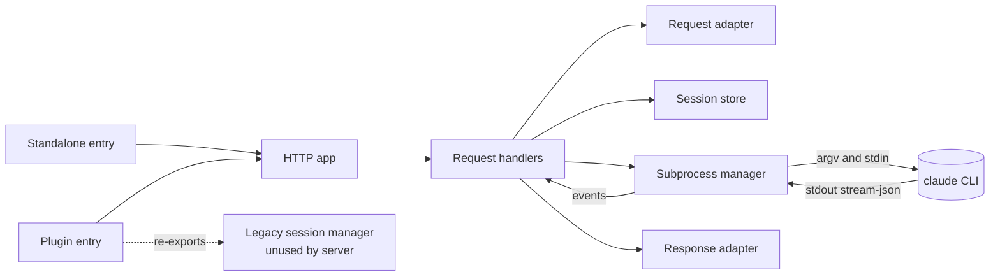

# Architecture

This is the map of claude-max-api-proxy: what it does, which component owns what, its public interfaces, and its sharp edges. Use it to decide which components a task touches.
Runtime flows are in [WORKFLOW.md](WORKFLOW.md), and the reasons for design choices are in [adrs/](adrs/README.md).
"Old `DESIGN.md`", "old `PROTOCOL.md`" and "old root `ARCHITECTURE.md`" are the original planning notes. They were removed after commit `2074263`, and their still-true content is here. Read them with `git show 2074263:DESIGN.md`.

## Purpose

**Problem.** A Claude subscription (Pro, Max or Team) does not work through the normal API, because its OAuth token is scope-restricted (old `DESIGN.md`). The proxy gets around this by running the official `claude` CLI, which holds the subscription login, and presenting its output as an OpenAI-compatible HTTP API.

**Users.** One person on one machine. The main client is OpenClaw. Any OpenAI-compatible client that can reach `127.0.0.1:3456` also works. There is no multi-user mode.

**Category.** A local OpenAI-compatible server in front of a CLI agent. It is not a model gateway. The CLI is a full agent with its own tools (Bash, Read, Edit, WebFetch) and runs them without asking. A request is therefore a task for Claude Code. The client gets back the agent's final text. Tool calls never reach the client, and the proxy runs no tools itself.

**Non-obvious points**

- It was designed as a Clawdbot provider plugin (old `DESIGN.md`), but it runs as a standalone server under a macOS LaunchAgent. The plugin entry still exists. The plist is not in this repo; see [WORKFLOW.md](WORKFLOW.md#running-as-a-macos-launchagent).
- Clawdbot's provider system handles authentication only, not API execution (old root `ARCHITECTURE.md`). So this proxy is a local endpoint that the provider's base URL points at, not a backend inside Clawdbot. See [local-openai-proxy-over-clawdbot-backend](adrs/local-openai-proxy-over-clawdbot-backend.md).
- The fork is tuned for OpenClaw. OpenClaw system-prompt sections are stripped, and a tool-name mapping prompt is always appended, including for non-OpenClaw clients.
- The CLI keeps the credentials in the OS keychain. The proxy never reads them. Old `DESIGN.md` says `~/.claude/credentials.json`, which is stale.
- `total_cost_usd` in the CLI result is subscription usage, not API billing (old `PROTOCOL.md`). The proxy does not read it.

## Features

**API surface**

- `GET /health`, `GET /v1/models`, `POST /v1/chat/completions`, and `OPTIONS *`. Any other path returns a JSON 404.
- `stream: true` returns Server-Sent Events. Otherwise the response is one JSON body.
- Errors use the OpenAI error shape.

**Conversation handling**

- **Prompt flattening.** The whole `messages` array becomes one text prompt. System messages are wrapped in `<system>`, assistant messages in `<previous_response>`, and user text is passed through.
- **Session resume.** The client's `user` string maps to a CLI session ID. The first turn creates it with `--session-id`. Later turns use `--resume` and send only messages added since the last turn. Entries live in memory and expire after 6 hours idle.
- A request without `user` runs with `--no-session-persistence` and replays the full history each time.

**Streaming**

- Text deltas become `chat.completion.chunk` events as they arrive.
- A `\n\n` chunk separates text blocks when a new one starts after text was already sent.
- Usage is on the final chunk.
- A client disconnect kills the CLI.

**OpenClaw adaptation**

- Strips `## Tooling`, `## Tool Call Style`, `## OpenClaw CLI Quick Reference` and `## OpenClaw Self-Update` from system messages.
- Appends a map from OpenClaw tool names to Claude Code tools, such as `exec` to `Bash` and `memory_search` to `openclaw memory search`.

**Model selection**

- The model must be one of the supported IDs, or the request gets `404 model_not_found`. The prefixes `claude-code-cli/` and `claude-max/` are stripped first. The ID is passed unchanged to `claude --model`. The current list is in the [README](../README.md#supported-models).

**Operations**

- Port as the first argument, default 3456.
- `CLAUDE_BIN` selects the CLI binary.
- `DEBUG` logs requests and body prefixes. `DEBUG_SUBPROCESS` logs spawn arguments, prompt prefixes and stdout sizes.
- Startup checks that the CLI runs. The auth check is a no-op.
- Windows: resolves the bundled `claude.exe` behind the npm shim and kills the whole process tree. See [resolve-windows-exe-and-kill-process-tree](adrs/resolve-windows-exe-and-kill-process-tree.md).
- A 15-minute timeout per request. LaunchAgent setup is in [WORKFLOW.md](WORKFLOW.md#running-as-a-macos-launchagent).

**Accepted but ignored**

- `temperature`, `max_tokens`, `top_p`, `frequency_penalty`, `presence_penalty`: typed, never read.
- `tools` and `tool_choice`: not typed and not read. Tool-call forwarding is commented out.
- Image content blocks: only `text` and `input_text` blocks are kept. Images are dropped silently.
- Messages with role `tool`: dropped silently. The request type does not include that role either.

**Planned in the old design, never built**

- A process pool, a request queue and `maxConcurrent`. Every request spawns its own process with no limit.
- Plugin config options such as `timeout`, `maxConcurrent`, `sessionPersistence`, `debugMode` and `cwd`. The plugin's config schema is empty.
- Separate middleware, health and stream modules. Streaming logic lives in the request handlers.
- Tool bridging, cost tracking, model routing, response caching and multi-user support.

## Vocabulary

| Group | Term | Meaning |
|---|---|---|
| OpenAI side | Chat completion | Non-streaming response, `object: "chat.completion"`. |
| OpenAI side | Chunk | One streaming event, `object: "chat.completion.chunk"`. |
| OpenAI side | SSE | Server-Sent Events: `data: <json>` lines followed by a blank line, on a held-open response. |
| OpenAI side | `[DONE]` | The literal line `data: [DONE]`, which ends a stream. |
| OpenAI side | `user` | Optional client string. It is the only per-conversation key the proxy has. |
| CLI side | Print mode | `claude --print`: non-interactive, one prompt in, output out. |
| CLI side | stream-json | `--output-format stream-json`: one JSON object per stdout line. |
| CLI side | stream_event | A line that wraps a raw API streaming event. Present with `--include-partial-messages`. |
| CLI side | Content block | One piece of a message: `text` or `tool_use`. |
| CLI side | text_delta | A stream event delta carrying a piece of text. |
| CLI side | input_json_delta | A delta carrying partial JSON for a tool's input. Read but not forwarded. |
| CLI side | Result message | The final `type: "result"` line: final text, usage and per-model usage. |
| CLI side | Session id | UUID naming a persisted CLI conversation. `--session-id` creates it and `--resume` continues it. |
| CLI side | Partial messages | `--include-partial-messages`. Adds `stream_event` lines alongside the full `assistant` lines. |
| Proxy internals | Session key | The `user` value, used as the key in the session store. |
| Proxy internals | messageCount | Length of `messages` at the last successful turn. Marks where the delta starts. |
| Proxy internals | Delta prompt | Messages after `messageCount`, minus assistant messages. |
| Proxy internals | Supported model | One of the IDs the proxy accepts, passed unchanged to `--model`. |
| Proxy internals | Done chunk | The last streaming chunk, with `finish_reason: "stop"` and usage. |
| Proxy internals | Block separator | The `\n\n` chunk inserted between text blocks. |
| Host apps | OpenClaw | The agent app this fork is tuned for, and its main client. Its prompts are adapted. |
| Host apps | Clawdbot | The host the original plugin targeted (old `DESIGN.md`). `clawdbot` is an optional peer dependency. This doc does not say whether Clawdbot and OpenClaw are the same project. Treat them as separate names. |

**How these connect**

- `user` → session key → CLI session ID (stored, or a new UUID) → `--session-id` or `--resume`.
- `stream_event` text_delta → SSE chunk.
- Result message → done chunk and `[DONE]` when streaming. It becomes the whole response body when not streaming.

**Easily confused**

- The **legacy session manager** is file-backed (`~/.claude-code-cli-sessions.json`), keyed by a Clawdbot conversation ID, with a 24-hour TTL. The library entry exports it, but the server never uses it.
- The **session store** is the one the server uses. It is in memory, keyed by `user`, with a 6-hour TTL.

## Components



This table is the one place that maps components to files. The rest of the docs use the component names.

| Component | File | Responsibility |
|---|---|---|
| Standalone entry | `src/server/standalone.ts` | What runs. Parses the port, runs the startup checks, starts the server, handles SIGINT and SIGTERM. |
| Plugin entry | `src/index.ts` | Clawdbot provider plugin, the models it advertises, and the library exports. |
| HTTP app | `src/server/index.ts` | Express app: body parsing, debug log, CORS, routing, 404, error handler, listen and stop. |
| Request handlers | `src/server/routes.ts` | Chat completions (validation, model check, session resolution, streaming and non-streaming paths), models, health. |
| Request adapter | `src/adapter/openai-to-cli.ts` | The supported-model list and its check, prompt flattening, the OpenClaw strip, and the delta prompt. |
| Response adapter | `src/adapter/cli-to-openai.ts` | Builds the non-streaming body and the done chunk from a CLI result. |
| Subprocess manager | `src/subprocess/manager.ts` | Finds the CLI binary, builds arguments, spawns, parses stdout into events, times out and kills. Holds the OpenClaw mapping prompt and the startup checks. |
| Session store | `src/subprocess/session-store.ts` | In-memory `user` to CLI session map with TTL. |
| Legacy session manager | `src/session/manager.ts` | Old file-backed session map. Not used by the server. |
| Types | `src/types/` | OpenAI request and response shapes, CLI stream-json message shapes and type guards. |
| Tests | `src/**/*.test.ts` | An end-to-end test against the real CLI, Windows-only process-tree tests, and unit tests for the model check. See [WORKFLOW.md](WORKFLOW.md#tests). |

**Entry points**

- The **standalone entry** is what runs. The build output is `dist/server/standalone.js`. It is the `bin` target and the `npm start` script.
- The **plugin entry** registers provider `claude-code-cli` with aliases `claude-cli` and `claude-max`. Its auth flow asks for a port, starts the server and returns a base URL of `http://127.0.0.1:<port>/v1`. It also registers the `claude-cli:start`, `claude-cli:stop` and `claude-cli:status` commands.
- **Import side effects.** Importing the library loads the legacy session manager. At import time that module reads `~/.claude-code-cli-sessions.json` and starts an hourly timer that is not `unref`'d, which keeps a process alive. Importing the library is therefore not free. Do not add more side effects to the plugin entry.

**Model lists live in 2 places**

- The **supported-model list** in the request adapter. It drives validation, `GET /v1/models` and the 404 message. The e2e test compares `/v1/models` against it, so the test needs no edit when the list changes.
- The **advertised list** in the plugin entry: the few models the plugin's config patch offers OpenClaw. It is not used for validation.

Adding a model means adding it to the supported-model list and checking the ID against the CLI. Change the advertised list only if the plugin should offer it.

**Where to start reading**

1. The chat completions handler: validation (messages, then model), then session resolution, then the streaming or non-streaming path.
2. Session resolution, then the request adapter's full and delta prompt builders.
3. The subprocess manager: start, argument building, and stdout line parsing.
4. The event listeners in the streaming path.

## Interfaces / APIs

### Inbound HTTP (127.0.0.1:3456)

| Method and path | Behaviour |
|---|---|
| `GET /health` | `200 {"status":"ok","provider":"claude-code-cli","timestamp":"…"}` |
| `GET /v1/models` | `200 {"object":"list","data":[{"id","object":"model","owned_by":"anthropic","created"}]}` |
| `POST /v1/chat/completions` | Chat handler, below. |
| `OPTIONS *` | `200`, empty body. |
| anything else | `404 {"error":{"message":"Not found","type":"invalid_request_error","code":"not_found"}}` |

Every response carries `Access-Control-Allow-Origin: *`. See the [security review](security-review/bad-coding-practices.md) for what that means.

**Request fields actually used**

- `messages`: required. Must be a non-empty array, or the response is `400` with code `invalid_messages`.
- `model`: must be a supported ID, optionally prefixed with `claude-code-cli/` or `claude-max/`. Otherwise `404 model_not_found`. The ID is passed unchanged to the CLI.
- `stream`: streaming only when `=== true`.
- `user`: session key.
- Everything else is ignored, including the fields listed under "Accepted but ignored".

Only `Content-Type: application/json` is parsed. Any other content type leaves `messages` undefined, so the response is the 400 above. The body limit is 10 MB.

**Non-streaming response**

```json
{"id":"chatcmpl-<24 hex>","object":"chat.completion","created":1767000000,"model":"claude-sonnet-5-5",
 "choices":[{"index":0,"message":{"role":"assistant","content":"…"},"finish_reason":"stop"}],
 "usage":{"prompt_tokens":2,"completion_tokens":13,"total_tokens":15}}
```

`model` is the requested ID. `tool_calls` is never set. There is no `X-Request-Id` header on this path.

**Streaming response**

```
HTTP header: Content-Type: text/event-stream, X-Request-Id: <24 hex>

:ok

data: {"id":"chatcmpl-…","object":"chat.completion.chunk","created":…,"model":"…","choices":[{"index":0,"delta":{"role":"assistant","content":"Hel"},"finish_reason":null}]}

data: {…,"choices":[{"index":0,"delta":{"content":"lo"},"finish_reason":null}]}

data: {…,"choices":[{"index":0,"delta":{},"finish_reason":"stop"}],"usage":{"prompt_tokens":2,"completion_tokens":13,"total_tokens":15}}

data: [DONE]
```

The first chunk has `role`. Every chunk, including the done chunk, carries the requested ID as `model`. The usage block appears only if the CLI result had usage. `:ok` is the first line, sent before the subprocess starts.

**Errors**

- Validation: `400 {"error":{"message","type":"invalid_request_error","code":"invalid_messages"}}`.
- Missing, non-string or unsupported `model`: `404 {"error":{"message","type":"invalid_request_error","param":"model","code":"model_not_found"}}`. The message lists the supported IDs. Checked after the messages check, so an empty `messages` gets the 400.
- Anything thrown before streaming starts: `500`, `type: "server_error"`, `code: null`.
- Non-streaming CLI error, timeout or early exit: `500 server_error`.
- Malformed JSON, or a body over 10 MB: `500 server_error` with the parser message. These are not 400 or 413.
- Streaming, error during the run: a `data: {"error":{…}}` line, then the stream ends with no `[DONE]`.
- Streaming, CLI exits with no result: an error line, then `[DONE]`.

### Config surface

| Setting | Default | Notes |
|---|---|---|
| Port (first CLI argument) | 3456 | The only CLI argument. The plugin asks for it during setup. Not an env var. |
| Host | `127.0.0.1` | Library callers of the server start function can pass a host. Nothing in the repo does, and there is no CLI or env option. |
| `DEBUG` | off | Logs request lines and body prefixes (200 and 300 characters). |
| `DEBUG_SUBPROCESS` | off | Logs CLI arguments, a 200-character prompt prefix, stdout sizes and stderr. |
| `CLAUDE_BIN` | `claude` | Not cached, so changes take effect at the next spawn. |
| Request timeout | 15 min | The subprocess accepts a custom timeout, but no caller passes one. |
| Session TTL | 6 h idle | |
| Session prune | every 30 min | The timer is `unref`'d. |
| Body limit | 10 MB | |
| `CLAUDECODE` | stripped | Removed from the CLI's environment. |

None of these can be set per request.

### Outbound to the CLI

**Spawn.** One child per request, run in a fixed folder under the OS temp directory (created if missing) rather than the proxy's own directory, so the CLI does not load the repo's project context. The child gets the proxy's environment minus `CLAUDECODE`, piped stdio, and no shell. A shell is used only by the Windows shim fallback.

**Arguments**, in order:

```
claude --print --dangerously-skip-permissions --output-format stream-json --verbose
       --include-partial-messages --model <full model ID>
       --append-system-prompt <OpenClaw tool-mapping prompt>
       <one session flag, below>
```

The session flag has three branches:

- Stored session for this `user` → `--resume <id>`. Existing session, delta prompt.
- `user` with no stored session → `--session-id <new UUID>`. First turn for that `user`.
- No `user` → `--no-session-persistence`.

**Stdin.** The prompt is written as plain text, then stdin is closed. There is no `--input-format` flag. The `user_message` JSON idea in old `PROTOCOL.md` was never used.

**Stdout.** Newline-delimited JSON, split into lines and parsed one by one. Non-JSON lines are emitted as `raw`, and nothing listens to them. Stderr is logged only under `DEBUG_SUBPROCESS` and never fails a request. A non-zero exit with no result is an error.

### CLI output message types

"Used by proxy" reflects what the subprocess manager emits and which events the request handlers listen to.

| Message (`type` / `subtype` or `event.type`) | Used by proxy? |
|---|---|
| `system` / `init` | No. Only the generic `message` event carries it, and nothing listens. |
| `system` / `hook_started`, `hook_response` | No. |
| `assistant` | No. Emitted, but nothing listens. `tool_use` blocks are read only in commented-out code. |
| `result` | Yes. Streaming: usage, done chunk, session save. Non-streaming: the whole body. `subtype` and `is_error` are never read. |
| `stream_event` / `content_block_delta` with `text_delta` | Yes. Becomes an SSE chunk. |
| `stream_event` / `content_block_start` with `text` | Yes. Triggers the block separator. |
| `stream_event` / `content_block_start` with `tool_use` | Emitted as `tool_use_start`. Listened to only in commented-out code. |
| `stream_event` / `content_block_delta` with `input_json_delta` | Emitted. Listened to only in commented-out code. |
| `stream_event` / `content_block_stop` | Emitted. Listened to only in commented-out code. |
| `stream_event` / `message_start`, `message_delta`, `message_stop` | No. |
| Any other `type` | No. Emitted only as `message`. |

Shape examples, trimmed from old `PROTOCOL.md` (captured output, not a spec):

```json
{"type":"stream_event","event":{"type":"content_block_delta","index":0,"delta":{"type":"text_delta","text":"Hel"}},"session_id":"72db4887-…","uuid":"…"}
```

```json
{"type":"result","subtype":"success","is_error":false,"duration_ms":3613,"num_turns":1,"result":"The final text response","session_id":"72db4887-…","total_cost_usd":0.159,"usage":{"input_tokens":2,"output_tokens":13,"cache_creation_input_tokens":42255,"cache_read_input_tokens":0},"modelUsage":{"claude-sonnet-4-5-20250929":{"inputTokens":2,"outputTokens":13,"costUSD":0.158}}}
```

## Task → components

| Task | Start here | Also touch | ADR |
|---|---|---|---|
| Add or rename a model | Supported-model list (request adapter) | The plugin's advertised list, only if the plugin should offer it. The models endpoint and the e2e test follow the list. Check the ID against the CLI. | [pass-full-model-ids-to-cli](adrs/pass-full-model-ids-to-cli.md) |
| Change prompt formatting | Prompt flattening (request adapter) | Content-block text extraction; OpenAI content types; the delta prompt filter | [flatten-messages-into-one-prompt](adrs/flatten-messages-into-one-prompt.md) |
| Support images | Content-block text extraction (request adapter) | OpenAI content types; the prompt is text-only on stdin (subprocess manager) | [flatten-messages-into-one-prompt](adrs/flatten-messages-into-one-prompt.md) |
| Change CLI flags, permissions or allowed tools | Argument building (subprocess manager) | The OpenClaw mapping prompt; the subprocess manager tests | [skip-cli-permission-prompts](adrs/skip-cli-permission-prompts.md), [keep-tool-execution-inside-cli](adrs/keep-tool-execution-inside-cli.md) |
| Streaming output bugs | Streaming path (request handlers) | Stdout line parsing (subprocess manager); `stream_event` type guards; the block separator | [stream-text-deltas-as-sse](adrs/stream-text-deltas-as-sse.md) |
| Non-streaming response shape or usage | Response adapter | Non-streaming path (request handlers); CLI result usage types | None (see sharp edges) |
| Multi-turn or session bugs | Session resolution (request handlers) | Session store; delta prompt (request adapter); every place that saves or clears a session on result, error or close | [resume-cli-sessions-keyed-by-user](adrs/resume-cli-sessions-keyed-by-user.md) |
| Auth, CORS or security hardening | CORS and OPTIONS (HTTP app); the auth check (subprocess manager) | Host binding (HTTP app); the permissions flag; [security review](security-review/bad-coding-practices.md) | [localhost-only-no-auth-open-cors](adrs/localhost-only-no-auth-open-cors.md) |
| Timeouts, kill or orphaned processes | Timeout and kill (subprocess manager) | Process-tree kill; the disconnect handler in the streaming path | [resolve-windows-exe-and-kill-process-tree](adrs/resolve-windows-exe-and-kill-process-tree.md) |
| Windows issues | CLI binary lookup (subprocess manager) | Process-tree kill; spawn options | [resolve-windows-exe-and-kill-process-tree](adrs/resolve-windows-exe-and-kill-process-tree.md) |
| Request validation or body parse errors | Validation in the chat completions handler | Body parser and error handler (HTTP app) | None |
| OpenClaw prompt behaviour | OpenClaw strip (request adapter) | OpenClaw mapping prompt (subprocess manager) | [adapt-openclaw-prompts](adrs/adapt-openclaw-prompts.md) |
| Re-enable tool-call forwarding | The commented-out tool blocks in both response paths (request handlers) | The response adapter's unused tool-calls parameter; OpenAI tool-call types; the tool events the subprocess manager still emits | [keep-tool-execution-inside-cli](adrs/keep-tool-execution-inside-cli.md) |
| Startup checks | Standalone entry | CLI and auth checks (subprocess manager) | None |
| Clawdbot plugin | Plugin entry | Legacy session manager | [local-openai-proxy-over-clawdbot-backend](adrs/local-openai-proxy-over-clawdbot-backend.md) |
| Spawn options, cwd or env | Spawn (subprocess manager) | The `CLAUDECODE` filter | [spawn-one-cli-process-per-request](adrs/spawn-one-cli-process-per-request.md) |
| Logging | `DEBUG` (HTTP app) | `DEBUG_SUBPROCESS` (subprocess manager); logs use `console` throughout | None |

## Sharp edges

Items marked **inferred** come from reading the code. They have not been run.

- **A JSON `null` body crashes the process.** `JSON.parse("null")` makes the body `null`. The handler reads `body.stream` before its `try` block. The async handler rejects, and Express 4 does not catch that. Node exits on an unhandled rejection by default. Also in the [security review](security-review/bad-coding-practices.md).
- **Input token counts are low when caching is used.** Only `input_tokens` and `output_tokens` are copied. The cache token fields exist in the CLI result and are dropped. The old `PROTOCOL.md` example reports `input_tokens: 2` next to `cache_creation_input_tokens: 42255`.
- **CLI error results look like successes.** `is_error` and `subtype` are never read, and `finish_reason` is always `"stop"`. A failed run can come back as HTTP 200 with the error text as content. The session is still saved for that turn, so the next turn resumes after the failed one. **Inferred.**
- **Streaming and non-streaming can return different text.** Streaming forwards every text delta, including text from earlier turns of the CLI's tool loop. Non-streaming returns only the result message's final text. **Inferred.**
- **A shrunken history floods the resumed session.** If `messages` gets shorter than the stored `messageCount`, the delta is empty, and the full history is sent into the resumed session. Edits that keep the length the same are not sent, because only the tail is. **Inferred.**
- **Two concurrent requests with the same `user` share one session.** Nothing serializes turns, and both `--resume` the same ID. Behaviour under concurrent `--resume` is untested.
- **The session map is lost on restart.** It lives in process memory. The next turn starts a new CLI session with the full history. The CLI's own transcripts stay on disk.
- **A non-streaming client that disconnects does not stop the CLI.** Only the streaming path listens for the response closing. The CLI runs until it finishes or hits the 15-minute timeout. **Inferred.**
- **On macOS and Linux, kill signals only the direct child.** Descendants such as Bash-tool processes are not reached. Timeouts and client disconnects both use this path. Windows uses `taskkill /T`.
- **Listener exceptions are swallowed.** Stdout parsing wraps event emission in the same `try` as the JSON parse. A throw in a request-handler listener becomes a `raw` event that nothing listens to, so the failure is silent. **Inferred.**
- **The auth check always passes.** A logged-out CLI shows up on the first request, not at startup.
- **Malformed JSON and oversized bodies return 500.** They go to the generic error handler, so the client gets `500 server_error`, not 400 or 413.
- **Dead code.** The response adapter has an unused per-message chunk converter. The CLI types have an unused init-message guard. The subprocess manager has an unused is-running check and an unused typed events interface. The tool-call ID helper in the request handlers is used only in commented-out code. Read [keep-tool-execution-inside-cli](adrs/keep-tool-execution-inside-cli.md) before wiring any of these up.
- **Stale naming.** The session store's header comment calls the key a "Hermes conversation key". It is just the request's `user` field. The legacy session manager's header describes Clawdbot IDs, which the server does not use.
