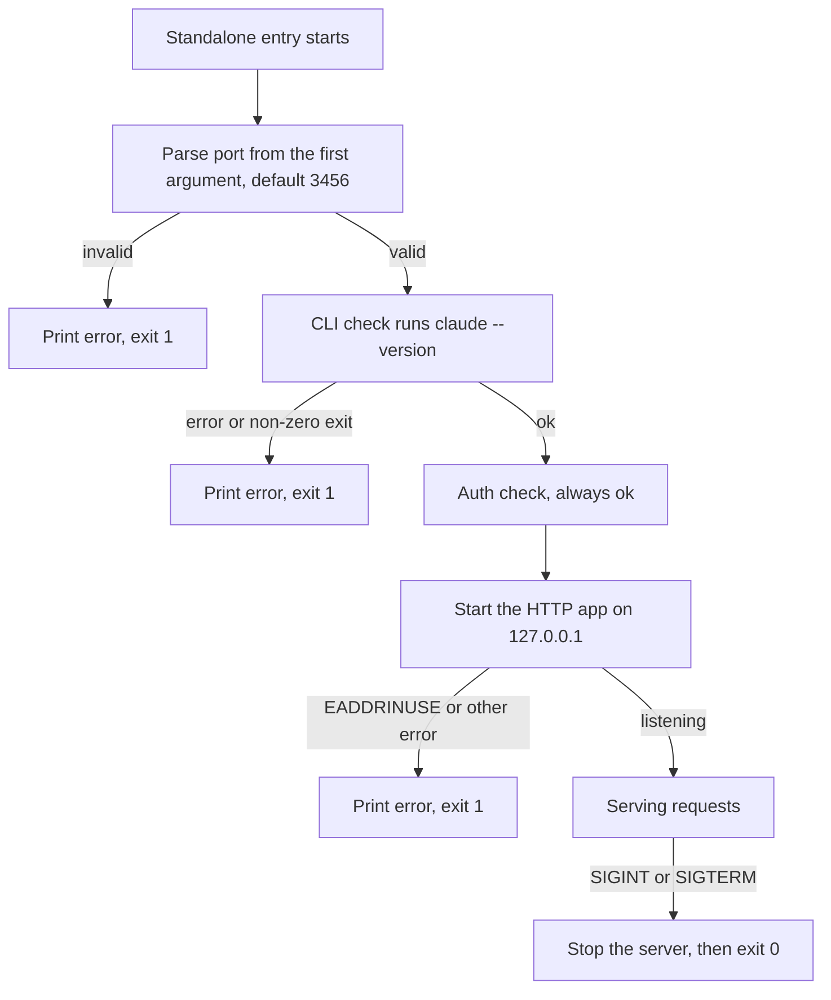
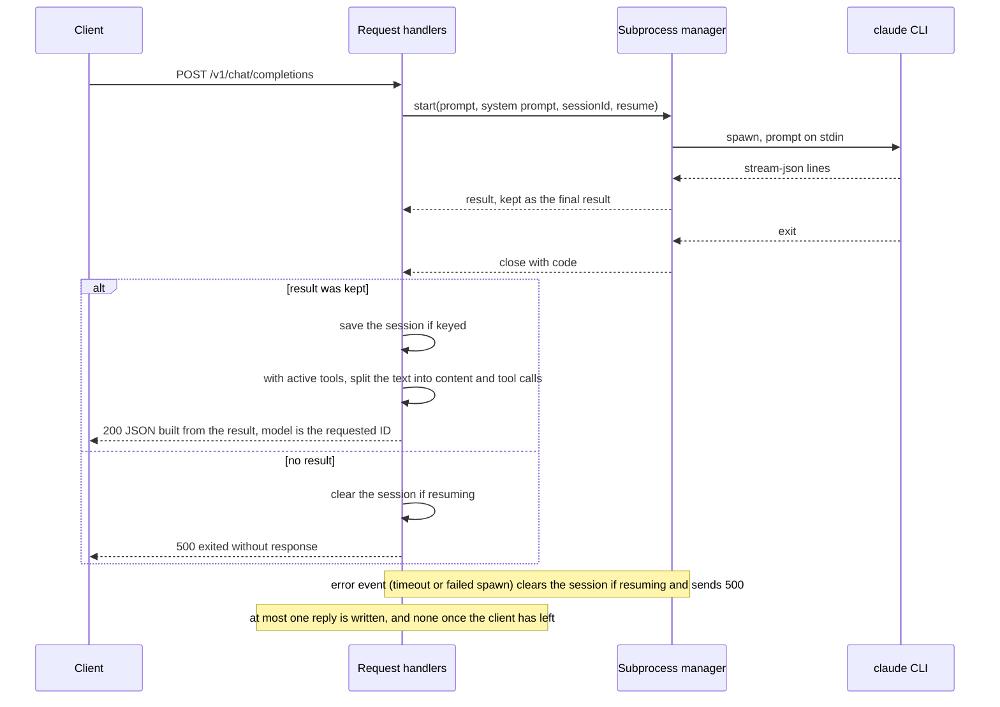
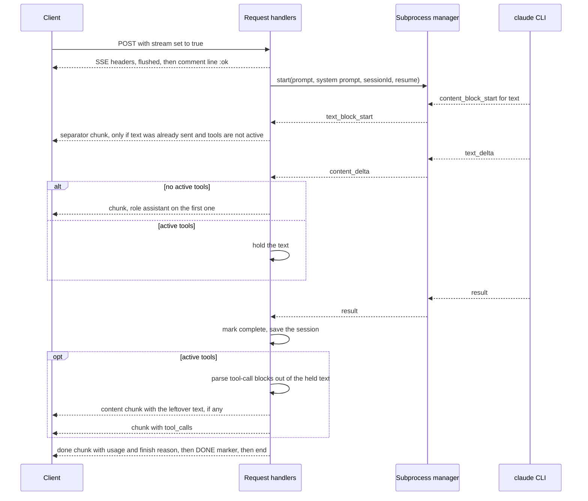
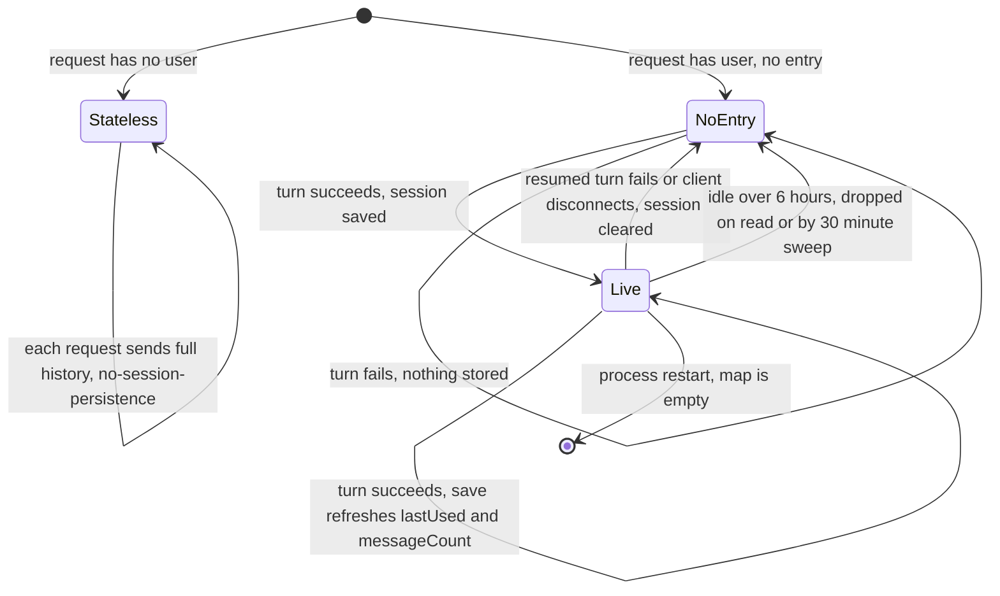

# Runtime workflow

This page traces what happens at runtime: startup, each request, the CLI child process, the two response paths, session reuse, and timeouts. Use it to find the component responsible for a bug.

- For the components and what each owns, see [ARCHITECTURE.md](ARCHITECTURE.md#components).
- For why each choice was made, see the [ADR index](adrs/README.md).

## 1. Startup



**Notes**

- `npm start` runs the standalone server. The optional LaunchAgent (see section 7) can run the same server. Only the CLI check can stop startup. The auth check never fails, so a CLI that is not logged in still starts. Errors show up on the first real request.
- Stopping the server closes the listener and waits for open connections. An in-flight streaming response delays exit (inferred, not tested).
- Shutdown does not signal CLI children itself. Run by hand, a running `claude` can outlive the server. Under launchd, stopping the job also kills the rest of its process group unless the plist sets `AbandonProcessGroup`, so children are normally cleaned up (inferred, not tested).

**Plugin path (not how the proxy is normally run)**

The plugin entry registers a provider. The provider's auth flow repeats the CLI and auth checks, asks for a port, starts the server, and returns a config that points the host at `http://127.0.0.1:<port>/v1`. The plugin's unload hook stops the server. Nothing in the LaunchAgent setup uses this path.

## 2. Request pipeline

Each HTTP request passes these steps in order.

1. **Body parsing** (HTTP app). Bodies whose `Content-Type` is `application/json` are buffered raw (10 MB limit) and then parsed with `JSON.parse`. A parse failure goes to the error handler, which returns **500**, not 400.
2. **Debug log.** Prints method and path when `DEBUG` is set.
3. **CORS headers** on every response. `OPTIONS` gets 200 before any route runs.
4. **Routing**: `GET /health`, `GET /v1/models`, `POST /v1/chat/completions`. Anything else gets a JSON 404.
5. **Chat completions handler** (request handlers). Makes a 24-character request ID. Streaming is on only when `stream` is exactly `true`.
6. **Validation.** `messages` must be a non-empty array, otherwise 400 `invalid_messages`.
7. **Model check.** `model` must be a supported ID, with an optional `claude-code-cli/` or `claude-max/` prefix. Otherwise 404 `model_not_found`, with the supported IDs in the message. This runs before any CLI call, so no quota is used.
8. **Session resolution and prompt building.** Returns the prompt, the system prompt, the session ID, and whether to resume. The system prompt is built here for every request: the base line, the text of every `system` and `developer` message, and, when the request has active tools, the client tool catalog and the calling protocol. The handler also notes whether the request has active tools, which decides how steps 10 and 11 treat the reply. See section 5 for the session part.
9. **New subprocess.** One per request. See [spawn-one-cli-process-per-request](adrs/spawn-one-cli-process-per-request.md).
10. **Branch.** `stream: true` takes the streaming path. Otherwise the non-streaming path runs.
11. **Outer catch.** A synchronous throw becomes a 500, unless headers were already sent.

Steps 5 and later write the request summary line described in the dev loop section, whatever the outcome. A request that fails before step 5, such as an unparseable body or an unknown path, gets no summary line; the body parser prints its own error instead.

**Gotchas**

- A request without a JSON content type gets 400 `invalid_messages`, because the body is never parsed. `curl -d` sends `application/x-www-form-urlencoded` by default, so always pass `-H "Content-Type: application/json"` (inferred from body-parser behaviour, not run).
- A JSON body of `null` makes the `stream` read throw outside the handler's `try`. The rejection is unhandled and the process exits (inferred, not run). Under the optional LaunchAgent, `KeepAlive` restarts it. Run by hand, it stays down until you start it again.

## 3. Subprocess lifecycle

The subprocess manager wraps one CLI child and reports what it does as events. Its steps:

1. **Start.** With `DEBUG_SUBPROCESS` set, logs the args (which include the system prompt) and the first 200 characters of the prompt.
2. **Build arguments.** Always passes `--print --dangerously-skip-permissions --output-format stream-json --verbose --include-partial-messages --model <full model ID>`. The model ID is passed unchanged (see [pass-full-model-ids-to-cli](adrs/pass-full-model-ids-to-cli.md)). Then the no-tools flags `--tools ""`, `--strict-mcp-config` and `--safe-mode`, then `--system-prompt` with the proxy's system prompt. Then one session flag:
   - `--resume <id>` when resuming;
   - `--session-id <id>` for a new keyed session;
   - `--no-session-persistence` when the request has no `user`.
3. **Spawn.** Runs in a fixed folder under the OS temp directory, created if missing, so the CLI does not load the repo's project context. The environment is the parent's minus `CLAUDECODE`, with piped stdio. No shell on macOS and Linux. The binary is `CLAUDE_BIN` if set, otherwise `claude` from PATH. On Windows it resolves to the bundled `.exe`. See [resolve-windows-exe-and-kill-process-tree](adrs/resolve-windows-exe-and-kill-process-tree.md).
4. **Arm timeout.** 15 minutes by default. The request handlers never pass a custom timeout.
5. **Prompt on stdin.** The user prompt is written and stdin is closed. Sending it on stdin avoids `E2BIG` on large inputs. The system prompt goes on the command line instead, so it does not get the same protection.
6. **stdout.** Chunks are appended to a buffer, split on newlines, and the last partial line is kept for the next chunk. Each line is trimmed and parsed as JSON. Lines that do not parse are emitted as `raw`.
7. **stderr.** Logged only when `DEBUG_SUBPROCESS` is set. Never emitted as an event.
8. **Exit.** Clears the timer, parses any leftover buffer, and emits `close` with the exit code.
9. **Resolve.** Start resolves right after the spawn call returns, before the process has done anything. A spawn failure is reported later, as an `error` event (see the spawn failure note).

**Events emitted by the subprocess**

| Event | Fires when | Listener in request handlers | Effect |
|---|---|---|---|
| `message` | Every parsed JSON line | none | none |
| `text_block_start` | `content_block_start` with a text block | streaming | Streaming: writes a `"\n\n"` chunk if text was already sent. With active tools: adds the separator to the held text. |
| `tool_use_start` | `content_block_start` with a tool_use block | none | none. Does not fire while the CLI has no tools. |
| `input_json_delta` | `content_block_delta` of type input_json_delta | none | none. Does not fire while the CLI has no tools. |
| `content_block_stop` | `content_block_stop` | none | none |
| `content_delta` | `content_block_delta` with text_delta | streaming | Writes an SSE chunk, or holds the text when the request has active tools |
| `assistant` | Full assistant message, not a delta | none | none |
| `result` | Result message | streaming and non-streaming | Ends the response. With active tools, tool-call blocks are pulled out of the text first. |
| `raw` | A line that does not parse | none | none |
| `error` | A timeout, or the CLI could not be spawned | streaming and non-streaming | Error reply |
| `close` | Child process exits | streaming and non-streaming | Ends the response if not already ended |

**Notes**

- Text deltas are matched before full assistant messages, so a text delta never reaches the `assistant` branch.
- `error` is emitted by the timeout and by a failed spawn. Other child failures reach the request handlers through `close`. See the spawn failure note below.
- The `try` around JSON parsing also wraps the event emission. An exception thrown by a listener is caught there and reported as `raw`. If a handler looks silent, check the `raw` lines (inferred from code).

**Spawn failure (missing CLI)**

A spawn failure, such as a missing CLI binary, is emitted as the subprocess's `error` event, and `close` still follows. A missing CLI gets the friendly "Claude CLI not found" message; other spawn errors pass their own message through. Both request paths handle the event:

- non-streaming: 500 with that message as the error;
- streaming: one error line with that message, then the stream ends with no `[DONE]`.

Both were checked on a live server with the CLI path pointed at a missing binary.

If starting throws before the process exists, the start call rejects instead. The streaming path then writes the same error line and ends the stream. Headers are already sent by then, so the status cannot change. The startup CLI check normally catches a missing CLI before any request arrives (inferred from code, not run).

## 4. Response flows

### 4.1 Non-streaming



**Notes**

- If the client leaves before the reply is written, the CLI is killed and the summary line is written as `aborted`. If the CLI still produces a result, that result is dropped: it is not sent or saved as a session, and a resumed session is cleared, because it would hold a reply the client never got. The kill and the `aborted` line were checked on a live server; the late-result case is inferred from code.
- Non-streaming does not use `assistant` events. The response is built from the `result` message alone.
- With active tools, the body is a tool-call reply when blocks parse: `content` is the leftover text or null, `tool_calls` is set, and `finish_reason` is `tool_calls`. If any block is malformed, the body is the plain text with `stop`, and a warning is logged.
- The reply's `model` is the requested ID with any provider prefix removed, not a name reported by the CLI.

### 4.2 Streaming



**Wire output (abbreviated, 4 lines; real output has a blank line after each event)**

```
:ok
data: {"id":"chatcmpl-<requestId>","object":"chat.completion.chunk","model":"claude-haiku-4-5","choices":[{"index":0,"delta":{"role":"assistant","content":"Hel"},"finish_reason":null}]}
data: {"id":"chatcmpl-<requestId>","object":"chat.completion.chunk","model":"claude-haiku-4-5","choices":[{"index":0,"delta":{},"finish_reason":"stop"}],"usage":{...}}
data: [DONE]
```

**Branches**

- **Client disconnects before completion**: the response's `close` event kills the subprocess. The handler listens on the response rather than the request, because the request's `close` fires as soon as the body is read.
- **Child exits non-zero with no result**: clears the session if resuming, writes an error line `Process exited with code <n>`, then `[DONE]`, then ends. A null code (killed by signal) also takes this path.
- **Child exits 0 with no result**: writes `[DONE]` and ends, with no error line (inferred from code).
- **Timeout error**: clears the session if resuming, writes an error line, ends. No `[DONE]`.
- **Spawn failure** (missing CLI, or a start that throws): clears the session if resuming, writes one error line, ends. No `[DONE]`. Logged as `finish=error`.
- **Active tools, reply has valid tool-call blocks**: the leftover text (if any) is one content chunk, then one chunk with all the `tool_calls`, then the done chunk with finish reason `tool_calls`.
- **Active tools, reply has no blocks or a malformed one**: the whole text goes out as one content chunk, and the done chunk has finish reason `stop`. A malformed block (the rules are under Fallback to text in ARCHITECTURE) is logged as a warning that carries the request ID and up to 200 characters of the failing block.

**Rules**

- Every chunk's `model` is the requested ID with any provider prefix removed.
- With active tools, the model's tool calls are returned as `tool_calls`. The model writes them as tagged JSON blocks at the end of its text, the proxy turns them into calls, and the finish reason becomes `tool_calls`. Streaming holds all text until the run ends in that case. See [run-cli-as-plain-llm-with-prompt-tool-calls](adrs/run-cli-as-plain-llm-with-prompt-tool-calls.md).
- Usage comes from the result message's `usage`, mapped as the response shapes in ARCHITECTURE describe. The done chunk omits `usage` when the CLI result has none.
- See [stream-text-deltas-as-sse](adrs/stream-text-deltas-as-sse.md) for why streaming works this way.

## 5. Session lifecycle

The session store links an OpenAI `user` value to a Claude CLI session ID. It is held in memory only.



**Rules**

- **Stateless**: `--no-session-persistence`, full history every turn.
- **New keyed session**: a new UUID is used as the session ID, sent with `--session-id`. The full history is sent, with system and developer text in the system prompt rather than the prompt. The session is saved with the current message count only after a `result` arrives.
- **Resumed turn**: the delta prompt keeps only messages at or after the stored `messageCount`. It renders the user and tool messages among them, and drops assistant messages, because the CLI wrote those itself. Tool messages are how tool output reaches a resumed session. The request uses `--resume`, and the system prompt is built and sent again, so the tool catalog for this request is current.
- **Empty delta**: if no new user or tool message exists, the full history is sent with `--resume`. That can duplicate content in the resumed session.
- **Self-heal**: any failure while resuming clears the session. The next turn starts a new session with the full history.
- **TTL**: 6 hours, measured from `lastUsed`. Only a save updates `lastUsed`; a read does not. Expired entries are removed when read, and swept every 30 minutes. The sweep timer is `unref`'d.
- **Restart**: the map starts empty. CLI transcripts stay under `~/.claude/projects/`. Nothing in the proxy deletes them.
- **Client disconnect while resuming** clears the session, because the streaming close handler runs before the turn is marked complete (inferred from code).
- **Overlapping requests** with the same `user` are not serialized. Both can `--resume` the same session (inferred, not tested).
- The legacy session manager is a separate library-level session map. The request handlers do not use it.

## 6. Timeouts, disconnects, kill

- **Timeout.** After 15 minutes, the subprocess manager sends SIGTERM through the kill path (the whole tree only on Windows) if the process is not already killed. It then emits `error` with `Request timed out after 900000ms`. The error listener sends the error reply and clears the session if resuming.
- **Streaming disconnect.** The response's `close` event kills the subprocess. The child exits with a null code and the close listener runs its failure branch. Nothing else happens; the request is not retried.
- **Non-streaming disconnect.** Before the reply is written, the response's `close` event kills the subprocess and the summary line is written as `aborted`. A result that arrives after that is dropped, and a resumed session is cleared. The kill and the `aborted` line were checked on a live server; the late-result case is inferred from code.
- **Kill, Windows.** `taskkill /PID <pid> /T /F` removes the whole process tree. If taskkill fails, the code signals only the root process and reports the kill as not done, so the caller can retry.
- **Kill, macOS and Linux.** Signals only the direct child. Processes the CLI started can survive (a code comment says so). With the CLI's tools turned off, there are few such processes to start.
- Kill is idempotent: a second call does nothing.

## 7. Development and operations

### Dev loop

```bash
npm install                            # express, uuid, typescript and @types
npm run build                          # tsc, output to dist/ (rootDir is src)
npm run dev                            # tsc --watch; restart the server yourself after changes
npm start                              # node dist/server/standalone.js on port 3456
node dist/server/standalone.js 3457    # custom port, 1 to 65535
```

Manual checks. These call the real CLI and use subscription quota. `claude-haiku-4-5` keeps cost down:

```bash
curl -s http://127.0.0.1:3456/health
curl -s http://127.0.0.1:3456/v1/models
curl -s http://127.0.0.1:3456/v1/chat/completions \
  -H "Content-Type: application/json" \
  -d '{"model":"claude-haiku-4-5","user":"dev-1","messages":[{"role":"user","content":"Say hi"}]}'
curl -N http://127.0.0.1:3456/v1/chat/completions \
  -H "Content-Type: application/json" \
  -d '{"model":"claude-haiku-4-5","stream":true,"messages":[{"role":"user","content":"Count to 3"}]}'
```

An unsupported model returns 404 `model_not_found` before the CLI runs, so this check costs no quota:

```bash
curl -s http://127.0.0.1:3456/v1/chat/completions \
  -H "Content-Type: application/json" \
  -d '{"model":"claude-opus-4","messages":[{"role":"user","content":"hi"}]}'
```

Use `curl -N` for streaming, or curl buffers the SSE output. Send a second request with the same `user` to exercise the resume path.

**Request summary line (always on).** Each chat-completion request writes one line to the console when it finishes: after a success, after an error (validation errors included), or when the client disconnects. No flag controls it. Example:

```
[req 3f2a9c1e] model=claude-haiku-4-5 stream=true messages=4 tools=2 finish=tool_calls tool_calls=1 prompt=2048 cached=1900 completion=87 reasoning=0 1532ms
```

The fields, in order: the request ID (the same ID as the `X-Request-Id` header on streaming responses, and the part after `chatcmpl-` in the response ID), the model as the client sent it, the stream flag, the message count, the tool count, `finish` (`stop`, `tool_calls`, `error` or `aborted`), the number of tool calls returned, the prompt, cached, completion and reasoning tokens, and the duration. A token field shows `-` when the request produced no usage, as for errors and aborts. An error line ends with the error message in quotes, cut to 200 characters. The line holds no prompt or reply text. The exception is the tool-call warning, which is printed whether or not `DEBUG` is set and quotes up to 200 characters of a malformed block from the reply.

**Environment variables**

- `DEBUG`: one line per request, the first 200 characters of each body, and the first 300 characters on a parse error. Without `DEBUG`, a parse error logs only length, method and URL.
- `DEBUG_SUBPROCESS`: CLI args (including the system prompt) and the first 200 characters of the prompt, the child PID, stdout byte counts, the first 200 characters of stderr, and the exit code.
- `CLAUDE_BIN`: runs this binary instead of `claude`. Useful for pointing at a fake CLI.
- `CLAUDECODE` is always removed from the child environment.

Both debug flags log prompt fragments, so keep them off in normal use.

### Tests

- `npm test` runs `node --test dist/**/*.test.js`. Build first (`npm run build`), because the tests run from `dist/`.
- **End-to-end test.** Starts the real server on a random port and calls the real CLI with `claude-haiku-4-5`. It prints a quota warning when it starts and allows 120 seconds per test. **It uses subscription quota.** Run it with `node --test dist/e2e.test.js`.
- **Subprocess manager tests.** Windows process-tree termination, which is skipped on other platforms. A missing-binary test runs everywhere and checks that a spawn failure emits `error`, then `close`.
- **Request adapter test.** Unit tests for the model check (prefix stripping, unsupported IDs). It needs no CLI and no quota. Run it with `node --test dist/adapter/openai-to-cli.test.js`.
- **Glob caveat.** npm runs scripts with `sh`, where `**` without globstar acts like `*`. So `dist/**/*.test.js` matches test files one folder down but not the top-level `dist/e2e.test.js`, and `npm test` does not run the e2e test. Checked with `sh` in a scratch folder.

### Running as a macOS LaunchAgent

This section replaces the old `docs/macos-setup.md` (removed after commit `2074263`), which used the label `com.claude-code-provider` and logged to `/tmp`. This section is optional and is an example setup. The plist is not in this repo, so write it yourself and change the label, paths and user to match your machine. The normal way to run the proxy is `npm start`.

- **Label:** `com.openclaw.claude-max-proxy`
- **Plist:** `~/Library/LaunchAgents/com.openclaw.claude-max-proxy.plist`
- **Logs:** `~/.openclaw/logs/claude-max-proxy.log` (stdout) and `~/.openclaw/logs/claude-max-proxy.err.log` (stderr)

**Before loading**

1. Build the repo: `npm run build`, so `dist/server/standalone.js` exists.
2. Create the log folder. launchd does not create it, and the job will not start without it:

   ```bash
   mkdir -p ~/.openclaw/logs
   ```

3. Find the paths to fill into the plist:

   ```bash
   which node      # first ProgramArguments entry
   which claude    # its directory must be in PATH
   echo $HOME
   ```

4. Write the plist. Replace `YOU` and the paths.

```xml
<?xml version="1.0" encoding="UTF-8"?>
<!DOCTYPE plist PUBLIC "-//Apple//DTD PLIST 1.0//EN" "http://www.apple.com/DTDs/PropertyList-1.0.dtd">
<plist version="1.0">
<dict>
  <key>Label</key>
  <string>com.openclaw.claude-max-proxy</string>

  <!-- Absolute path to node (output of which node), then the built server, then the port -->
  <key>ProgramArguments</key>
  <array>
    <string>/opt/homebrew/bin/node</string>
    <string>/Users/YOU/source/experiments/llm/claude-max-api-proxy/dist/server/standalone.js</string>
    <string>3456</string>
  </array>

  <key>EnvironmentVariables</key>
  <dict>
    <key>HOME</key>
    <string>/Users/YOU</string>
    <!-- PATH must include the directory that holds claude (which claude). launchd's default PATH is minimal -->
    <key>PATH</key>
    <string>/Users/YOU/.local/bin:/opt/homebrew/bin:/usr/local/bin:/usr/bin:/bin</string>
    <!-- Turns off non-essential traffic such as telemetry and update checks -->
    <key>CLAUDE_CODE_DISABLE_NONESSENTIAL_TRAFFIC</key>
    <string>1</string>
    <!-- Do not set ANTHROPIC_API_KEY or ANTHROPIC_BASE_URL here. The API key can bill
         a different account, and the base URL sends every prompt to another host. -->
  </dict>

  <key>RunAtLoad</key>
  <true/>
  <key>KeepAlive</key>
  <true/>

  <key>StandardOutPath</key>
  <string>/Users/YOU/.openclaw/logs/claude-max-proxy.log</string>
  <key>StandardErrorPath</key>
  <string>/Users/YOU/.openclaw/logs/claude-max-proxy.err.log</string>
</dict>
</plist>
```

**Commands**

```bash
plutil -lint ~/Library/LaunchAgents/com.openclaw.claude-max-proxy.plist          # check the plist syntax
launchctl bootstrap gui/$(id -u) ~/Library/LaunchAgents/com.openclaw.claude-max-proxy.plist   # start
launchctl list com.openclaw.claude-max-proxy                                     # status and last exit code
curl -s http://127.0.0.1:3456/health                                             # check it answers
launchctl kickstart -k gui/$(id -u)/com.openclaw.claude-max-proxy                # restart with the same plist
launchctl bootout gui/$(id -u)/com.openclaw.claude-max-proxy                     # stop
tail -f ~/.openclaw/logs/claude-max-proxy.err.log                                # follow errors
```

After any plist change, run `bootout`, then `bootstrap`. `kickstart` does not reread the plist.

**Uninstall**

```bash
launchctl bootout gui/$(id -u)/com.openclaw.claude-max-proxy
rm ~/Library/LaunchAgents/com.openclaw.claude-max-proxy.plist
```

**Troubleshooting**

- **The health check fails after bootstrap.** Read the err log first.
- **Wrong `standalone.js` path.** The err log shows a Node module-not-found error. Check the path with `ls`.
- **`claude` not on PATH.** Startup prints `Claude CLI not found` and exits 1. Fix the PATH entry in the plist.
- **`node` not found.** `ProgramArguments` needs an absolute path. Use the output of `which node`.
- **`bootstrap` fails because the job is already loaded.** Run `bootout` first.
- **Port 3456 is in use.** The server exits 1 with `Port 3456 is already in use`. Find the owner with `lsof -iTCP:3456 -sTCP:LISTEN`.
- **The job restarts over and over.** `KeepAlive` restarts it after any crash. Check the err log for the stack trace. A `null` JSON body can cause this (section 2).

**Security**

The service has no authentication, sends `Access-Control-Allow-Origin: *`, and passes the CLI's skip-permissions flag. The CLI runs with no built-in tools, so a request cannot make it run shell commands or edit files on this machine; the skip flag guards nothing in practice. Read [bad-coding-practices section 3](security-review/bad-coding-practices.md#3-gotchas-if-you-dont-change-the-code) before you load it.

- If the service is loaded, stop it (`bootout`) when you are not using it.
- Never expose port 3456 beyond loopback.
- Keep `DEBUG` and `DEBUG_SUBPROCESS` unset, and keep logs out of `/tmp`.
- See [telemetry.md](security-review/telemetry.md) for what the CLI sends and which variables turn it off.
- The server's loopback-only design and its open CORS policy are recorded in [localhost-only-no-auth-open-cors](adrs/localhost-only-no-auth-open-cors.md).
