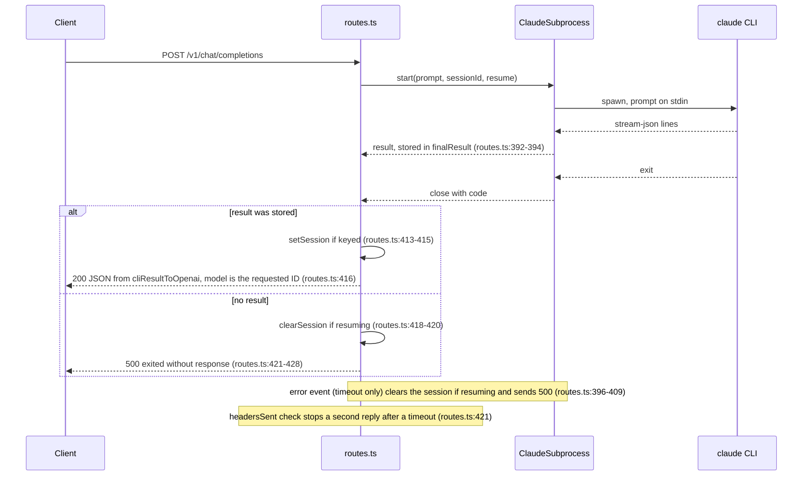
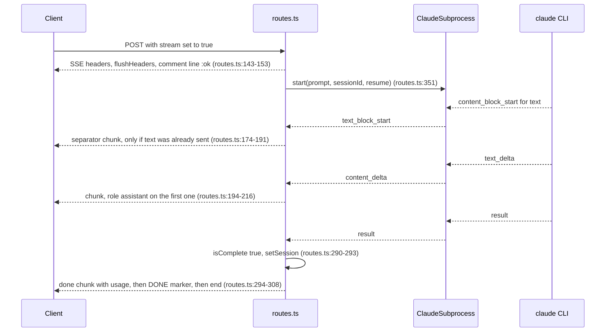
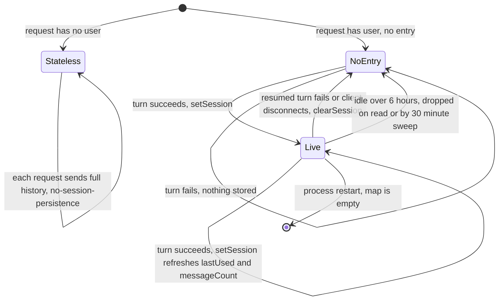

# Runtime workflow

This page traces what happens at runtime: startup, each request, the CLI child process, the two response paths, session reuse, and timeouts. Use it to find the handler responsible for a bug.

- For the static module layout, see [ARCHITECTURE.md](ARCHITECTURE.md).
- For why each choice was made, see the [ADR index](adrs/README.md).

Line numbers were last updated on 2026-11-23. Re-check them if the code has moved.

## 1. Startup

```mermaid
flowchart TD
  A["standalone.ts main (src/server/standalone.ts:16)"] --> B["Parse port from argv 2, default 3456 (:21-25)"]
  B -->|invalid| X1["Print error, exit 1"]
  B -->|valid| C["verifyClaude runs claude --version (manager.ts:420)"]
  C -->|error or non-zero exit| X2["Print error, exit 1 (:30-33)"]
  C -->|ok| D["verifyAuth, always ok (manager.ts:458-464)"]
  D --> E["startServer on 127.0.0.1 (server/index.ts:107-108)"]
  E -->|EADDRINUSE or other error| X3["Print error, exit 1 (:55-57)"]
  E -->|listening| F["Serving requests"]
  F -->|SIGINT or SIGTERM (:66-67)| G["stopServer, then exit 0 (:60-64)"]
```

**Notes**

- The LaunchAgent runs `dist/server/standalone.js`. Only `verifyClaude` can stop startup. `verifyAuth` never fails, so a CLI that is not logged in still starts. Errors show up on the first real request.
- `stopServer` calls `server.close()` and waits for open connections. An in-flight streaming response delays exit (inferred, not tested).
- Shutdown does not signal CLI children itself. Run by hand, a running `claude` can outlive the server. Under launchd, stopping the job also kills the rest of its process group unless the plist sets `AbandonProcessGroup`, so children are normally cleaned up (inferred, not tested).

**Plugin path (not how the service runs today)**

`src/index.ts` exports a plugin object. Its `register` (`src/index.ts:73`) registers a provider. The provider's `auth.run` (`src/index.ts:91-185`) repeats the CLI and auth checks, asks for a port, calls `startServer` (`:134`), and returns a config that points the host at `http://127.0.0.1:<port>/v1`. The plugin's unload hook stops the server (`:191-197`). Nothing in the LaunchAgent setup uses this path.

## 2. Request pipeline

Each HTTP request passes these steps in order.

1. **Body parsing** (`src/server/index.ts:25-50`). `express.raw` buffers bodies whose `Content-Type` is `application/json` (10 MB limit). A manual `JSON.parse` follows. A parse failure calls `next(err)`, and the error handler returns **500**, not 400 (`:90-99`).
2. **Debug log** (`:53-58`). Prints method and path when `DEBUG` is set.
3. **CORS headers** (`:61-66`) on every response. `OPTIONS` gets 200 before any route runs (`:69-71`).
4. **Routing** (`:74-76`): `GET /health`, `GET /v1/models`, `POST /v1/chat/completions`. Anything else gets a JSON 404 (`:79-87`).
5. **`handleChatCompletions`** (`src/server/routes.ts:60`). Makes a 24-character request ID (`:64`). `stream` is true only when `body.stream === true` (`:66`).
6. **Validation** (`routes.ts:70-79`). `messages` must be a non-empty array, otherwise 400 `invalid_messages`.
7. **Model check** (`routes.ts:81-91`). `extractModel` must accept `body.model` (a supported ID, with an optional `claude-code-cli/` or `claude-max/` prefix). Otherwise 404 `model_not_found`, with the supported IDs in the message. This runs before any CLI call, so no quota is used.
8. **Session resolution** (`resolveCliInput`, called at `routes.ts:94`, defined at `routes.ts:30-53`). Returns the prompt, the session ID, and whether to resume. See section 5.
9. **New subprocess** (`routes.ts:95`). One `ClaudeSubprocess` per request. See [spawn-one-cli-process-per-request](adrs/spawn-one-cli-process-per-request.md).
10. **Branch** (`routes.ts:98-102`). `stream: true` goes to `handleStreamingResponse`. Otherwise `handleNonStreamingResponse` runs.
11. **Outer catch** (`routes.ts:103-116`). A synchronous throw becomes a 500, unless headers were already sent.

**Gotchas**

- A request without a JSON content type gets 400 `invalid_messages`, because `req.body` is never parsed. `curl -d` sends `application/x-www-form-urlencoded` by default, so always pass `-H "Content-Type: application/json"` (inferred from body-parser behaviour, not run).
- A JSON body of `null` makes `body.stream` throw at `routes.ts:66`, which is outside the `try`. The rejection is unhandled and the process exits (inferred, not run). `KeepAlive` in the LaunchAgent restarts it.

## 3. Subprocess lifecycle

`ClaudeSubprocess` (`src/subprocess/manager.ts:194`) extends `EventEmitter`. Its steps:

1. **`start(prompt, options)`** (`manager.ts:203`). With `DEBUG_SUBPROCESS` set, logs the args and the first 200 characters of the prompt (`:206-209`).
2. **`buildArgs`** (`:295-324`). Always passes `--print --dangerously-skip-permissions --output-format stream-json --verbose --include-partial-messages --model <full model ID> --append-system-prompt <tool mapping>`. The model ID is passed unchanged (see [pass-full-model-ids-to-cli](adrs/pass-full-model-ids-to-cli.md)). Then one session flag:
   - `--resume <id>` when resuming;
   - `--session-id <id>` for a new keyed session;
   - `--no-session-persistence` when the request has no `user`.
3. **Spawn** (`:215-222`). `spawn(bin, args, { cwd: process.cwd(), env: parent env without CLAUDECODE, stdio: pipes, shell })`. `shell` is false on macOS and Linux. The binary is `CLAUDE_BIN` if set (`:110-114`), otherwise `claude` from PATH. On Windows it resolves to the bundled `.exe` (`:118-142`). See [resolve-windows-exe-and-kill-process-tree](adrs/resolve-windows-exe-and-kill-process-tree.md).
4. **Arm timeout** (`:224`). 15 minutes by default (`:48`). The routes never pass a custom timeout.
5. **Prompt on stdin** (`:241-242`). The prompt is written and stdin is closed. Sending it on stdin avoids `E2BIG` on large inputs.
6. **stdout** (`:249-256`). Chunks are appended to a buffer. `processBuffer` (`:329-371`) splits on newlines and keeps the last partial line. Each line is trimmed and parsed as JSON. Lines that do not parse are emitted as `raw`.
7. **stderr** (`:259-268`). Logged only when `DEBUG_SUBPROCESS` is set. Never emitted as an event.
8. **`close`** (`:271-281`). Clears the timer, parses any leftover buffer, and emits `close` with the exit code.
9. **Resolve** (`:284`). `start()` resolves right after the spawn call returns, before the process has done anything.

**Events emitted by the subprocess**

| Event | Fires when | Listener in routes | Effect |
|---|---|---|---|
| `message` | Every parsed JSON line (`manager.ts:339`) | none | none |
| `text_block_start` | `content_block_start` with a text block (`:341-344`) | streaming, `routes.ts:174` | Writes a `"\n\n"` chunk if text was already sent |
| `tool_use_start` | `content_block_start` with a tool_use block (`:346-348`) | none, tool forwarding disabled (`routes.ts:224`) | none |
| `input_json_delta` | `content_block_delta` of type input_json_delta (`:350-352`) | none, disabled (`routes.ts:256`) | none |
| `content_block_stop` | `content_block_stop` (`:354-356`) | none, disabled (`routes.ts:282`) | none |
| `content_delta` | `content_block_delta` with text_delta (`:358-360`) | streaming, `routes.ts:194` | Writes an SSE chunk |
| `assistant` | Full assistant message, not a delta (`:361-362`) | none | none |
| `result` | Result message (`:363-364`) | streaming `routes.ts:289`, non-streaming `routes.ts:392` | Ends the response |
| `raw` | A line that does not parse (`:366-368`) | none | none |
| `error` | Timeout only (`:404`) | streaming `routes.ts:312`, non-streaming `routes.ts:396` | Error reply |
| `close` | Child process exits (`:280`) | streaming `routes.ts:330`, non-streaming `routes.ts:411` | Ends the response if not already ended |

**Notes**

- `content_delta` is checked before `assistant` (`manager.ts:358-362`), so text deltas never reach the `assistant` branch.
- `error` is emitted only by the timeout (`manager.ts:404`). Other child failures reach routes through `close`. See the spawn failure note below.
- The `try` in `processBuffer` also wraps the `emit` calls. An exception thrown by a listener is caught there and reported as `raw`. If a handler looks silent, check the `raw` lines (inferred from code).

**Spawn failure (missing CLI)**

The spawn `error` handler (`manager.ts:227-238`) calls `reject`. The promise already resolved at `:284`, so the call does nothing, and the subprocess never emits `error`. Node then emits `close` with code -2 (ENOENT).

Tested with a missing stand-in binary on Node 22.22.2, not with `claude`: Node emitted `error` and then `close(-2)`, and the stdin write did not crash. So the request ends through the `close` path:

- non-streaming: 500 `Claude CLI exited with code -2 without response`;
- streaming: an error line `Process exited with code -2`, then `[DONE]`.

The friendly "Claude CLI not found" message (`manager.ts:229-234`) is lost. In practice `verifyClaude` at startup catches a missing CLI first.

## 4. Response flows

### 4.1 Non-streaming



**Notes**

- There is no client-disconnect handler in this path. If the client leaves, the CLI runs until it exits or times out (inferred).
- Non-streaming does not use `assistant` events. The response is built from the `result` message alone.
- The reply's `model` is the requested ID (`routes.ts:416`), not a name reported by the CLI.

### 4.2 Streaming



**Wire output (abbreviated, 4 lines; real output has a blank line after each event)**

```
:ok
data: {"id":"chatcmpl-<requestId>","object":"chat.completion.chunk","model":"claude-haiku-4-5","choices":[{"index":0,"delta":{"role":"assistant","content":"Hel"},"finish_reason":null}]}
data: {"id":"chatcmpl-<requestId>","object":"chat.completion.chunk","model":"claude-haiku-4-5","choices":[{"index":0,"delta":{},"finish_reason":"stop"}],"usage":{...}}
data: [DONE]
```

**Branches**

- **Client disconnects before completion** (`routes.ts:164-170`): `res` `close` calls `subprocess.kill()` and resolves. The code uses `res` rather than `req` because `req` closes once the body is read (comment at `routes.ts:130-133`).
- **Child exits non-zero with no result** (`routes.ts:330-346`): clears the session if resuming, writes an error line `Process exited with code <n>`, then `[DONE]`, then ends. A null code (killed by signal) also takes this path.
- **Child exits 0 with no result**: writes `[DONE]` and ends, with no error line (inferred from code).
- **Timeout error** (`routes.ts:312-328`): clears the session if resuming, writes an error line, ends. No `[DONE]`.

**Rules**

- Every chunk's `model` is the requested ID (`routes.ts:157`).
- Tool activity is not forwarded. See [keep-tool-execution-inside-cli](adrs/keep-tool-execution-inside-cli.md).
- Usage comes from `result.usage` (`routes.ts:296-304`). It is missing when the CLI omits it.
- Stream text is SSE through [stream-text-deltas-as-sse](adrs/stream-text-deltas-as-sse.md).

## 5. Session lifecycle

The session map links an OpenAI `user` value to a Claude CLI session ID. It is held in memory only, in `src/subprocess/session-store.ts`.



**Rules**

- **Stateless** (`routes.ts:48`, `manager.ts:318-320`): `--no-session-persistence`, full history every turn.
- **New keyed session** (`routes.ts:48-51`): a new UUID is used as the session ID, sent with `--session-id`. The full history is sent. `setSession(key, id, messages.length)` runs only after a `result` (`routes.ts:291-293`, `:413-415`).
- **Resumed turn** (`routes.ts:39-46`): `openaiToCliDelta` (`src/adapter/openai-to-cli.ts:159-174`) keeps only messages at or after the stored `messageCount` and drops assistant messages. The request uses `--resume`.
- **Empty delta**: if no new non-assistant message exists, the full history is sent with `--resume` (`openai-to-cli.ts:168-170`). That can duplicate content in the resumed session.
- **Self-heal**: any failure while resuming calls `clearSession` (`routes.ts:316-318`, `:332-335`, `:398-400`, `:418-420`). The next turn starts a new session with the full history.
- **TTL**: 6 hours (`session-store.ts:14`), measured from `lastUsed`. Only `setSession` updates `lastUsed`. `getSession` does not (`:34-42`). Expired entries are removed when read, and swept every 30 minutes (`:15`, `:32`). The sweep timer is `unref`'d.
- **Restart**: the map starts empty. CLI transcripts stay under `~/.claude/projects/`. Nothing in the proxy deletes them.
- **Client disconnect while resuming** clears the session, because the streaming `close` handler runs with `isComplete` false (`routes.ts:330-335`) (inferred from code).
- **Overlapping requests** with the same `user` are not serialized. Both can `--resume` the same session (inferred, not tested).
- `src/session/manager.ts` is a separate library-level session map. The routes do not use it.

## 6. Timeouts, disconnects, kill

- **Timeout.** After 15 minutes (`manager.ts:48`), `armTimeout` (`:397-407`) sends SIGTERM through `killProcessTree` if the process is not already killed. It then emits `error` with `Request timed out after 900000ms`. The error handler sends the error reply and clears the session if resuming.
- **Streaming disconnect.** `res` `close` calls `kill()` (`manager.ts:386-391`). The child exits with a null code and the close handler runs its failure branch. Nothing else happens; the request is not retried.
- **Non-streaming disconnect.** Not handled. The CLI runs to completion and the result is written to a closed socket (inferred).
- **Kill, Windows.** `taskkill /PID <pid> /T /F` removes the whole process tree (`manager.ts:164-172`). If taskkill fails, the code signals only the root process and returns false, so the caller can retry.
- **Kill, macOS and Linux.** `child.kill(signal)` signals only the direct child (`manager.ts:186-191`). Processes the CLI started, such as Bash tool calls, can survive (the code comment at `manager.ts:151-155` says so).
- `kill()` is idempotent through `isKilled` (`manager.ts:386-388`).

## 7. Development and operations

### Dev loop

```bash
npm install                            # express, uuid, typescript and @types
npm run build                          # tsc, output to dist/ (rootDir is src)
npm run dev                            # tsc --watch; restart the server yourself after changes
npm start                              # node dist/server/standalone.js on port 3456
node dist/server/standalone.js 3457    # custom port, 1 to 65535
```

Manual checks. These call the real CLI and use subscription quota. `claude-haiku-4-5` keeps cost down:

```bash
curl -s http://127.0.0.1:3456/health
curl -s http://127.0.0.1:3456/v1/models
curl -s http://127.0.0.1:3456/v1/chat/completions \
  -H "Content-Type: application/json" \
  -d '{"model":"claude-haiku-4-5","user":"dev-1","messages":[{"role":"user","content":"Say hi"}]}'
curl -N http://127.0.0.1:3456/v1/chat/completions \
  -H "Content-Type: application/json" \
  -d '{"model":"claude-haiku-4-5","stream":true,"messages":[{"role":"user","content":"Count to 3"}]}'
```

An unsupported model returns 404 `model_not_found` before the CLI runs, so this check costs no quota:

```bash
curl -s http://127.0.0.1:3456/v1/chat/completions \
  -H "Content-Type: application/json" \
  -d '{"model":"claude-opus-4","messages":[{"role":"user","content":"hi"}]}'
```

Use `curl -N` for streaming, or curl buffers the SSE output. Send a second request with the same `user` to exercise the resume path.

**Environment variables**

- `DEBUG`: one line per request (`src/server/index.ts:53-58`), the first 200 characters of each body (`:29-31`), and the first 300 characters on a parse error (`:37-38`). Without `DEBUG`, a parse error logs only length, method and URL (`:40-44`).
- `DEBUG_SUBPROCESS`: CLI args and the first 200 characters of the prompt (`manager.ts:206-209`), the child PID (`:244-246`), stdout byte counts (`:251-253`), the first 200 characters of stderr (`:264-266`), and the exit code (`:272-274`).
- `CLAUDE_BIN`: runs this binary instead of `claude` (`manager.ts:110-114`). Useful for pointing at a fake CLI.
- `CLAUDECODE` is always removed from the child environment (`manager.ts:217-219`).

Both debug flags log prompt fragments. Keep them off in the LaunchAgent.

### Tests

- `npm test` runs `node --test dist/**/*.test.js`. Build first (`npm run build`), because the tests run from `dist/`.
- `src/e2e.test.ts` (`:1-41`) starts the real server on a random port and calls the real CLI with `claude-haiku-4-5`. It prints a quota warning when it starts (`:18-21`) and allows 120 seconds per test (`:27`). **It uses subscription quota.**
- `src/subprocess/manager.test.ts` (`:1-20`) tests Windows process-tree termination. It is skipped on other platforms (`:9`, `:14`).
- `src/adapter/openai-to-cli.test.ts` tests `extractModel` (prefix stripping, unsupported IDs). It needs no CLI and no quota. After `npm run build`, run it with `node --test dist/adapter/openai-to-cli.test.js`.
- **Glob caveat.** npm runs scripts with `sh`, where `**` without globstar acts like `*`. Checked with `sh` in a scratch folder: `dist/**/*.test.js` matches `dist/adapter/openai-to-cli.test.js` and `dist/subprocess/manager.test.js`, but not the top-level `dist/e2e.test.js`. So `npm test` does not run the e2e test. To run it, use `node --test dist/e2e.test.js`.

### Running as a macOS LaunchAgent

This section replaces the old `docs/macos-setup.md` (removed after commit `2074263`), which used the label `com.claude-code-provider` and logged to `/tmp`. The values below come from `CLAUDE.md`.

- **Label:** `com.openclaw.claude-max-proxy`
- **Plist:** `~/Library/LaunchAgents/com.openclaw.claude-max-proxy.plist`
- **Logs:** `~/.openclaw/logs/claude-max-proxy.log` (stdout) and `~/.openclaw/logs/claude-max-proxy.err.log` (stderr)

**Before loading**

1. Build the repo: `npm run build`, so `dist/server/standalone.js` exists.
2. Create the log and sandbox folders. launchd does not create the log folder, and the job will not start without it:

   ```bash
   mkdir -p ~/.openclaw/logs ~/claude-proxy-sandbox
   ```

3. Find the paths to fill into the plist:

   ```bash
   which node      # first ProgramArguments entry
   which claude    # its directory must be in PATH
   echo $HOME
   ```

4. Write the plist. Replace `YOU` and the paths.

```xml
<?xml version="1.0" encoding="UTF-8"?>
<!DOCTYPE plist PUBLIC "-//Apple//DTD PLIST 1.0//EN" "http://www.apple.com/DTDs/PropertyList-1.0.dtd">
<plist version="1.0">
<dict>
  <key>Label</key>
  <string>com.openclaw.claude-max-proxy</string>

  <!-- Absolute path to node (output of which node), then the built server, then the port -->
  <key>ProgramArguments</key>
  <array>
    <string>/opt/homebrew/bin/node</string>
    <string>/Users/YOU/source/experiments/llm/claude-max-api-proxy/dist/server/standalone.js</string>
    <string>3456</string>
  </array>

  <!-- Empty folder. The CLI runs in this directory, so it does not start in / or your home folder -->
  <key>WorkingDirectory</key>
  <string>/Users/YOU/claude-proxy-sandbox</string>

  <key>EnvironmentVariables</key>
  <dict>
    <key>HOME</key>
    <string>/Users/YOU</string>
    <!-- PATH must include the directory that holds claude (which claude). launchd's default PATH is minimal -->
    <key>PATH</key>
    <string>/Users/YOU/.local/bin:/opt/homebrew/bin:/usr/local/bin:/usr/bin:/bin</string>
    <!-- Turns off non-essential traffic such as telemetry and update checks -->
    <key>CLAUDE_CODE_DISABLE_NONESSENTIAL_TRAFFIC</key>
    <string>1</string>
    <!-- Do not set ANTHROPIC_API_KEY or ANTHROPIC_BASE_URL here. The API key can bill
         a different account, and the base URL sends every prompt to another host. -->
  </dict>

  <key>RunAtLoad</key>
  <true/>
  <key>KeepAlive</key>
  <true/>

  <key>StandardOutPath</key>
  <string>/Users/YOU/.openclaw/logs/claude-max-proxy.log</string>
  <key>StandardErrorPath</key>
  <string>/Users/YOU/.openclaw/logs/claude-max-proxy.err.log</string>
</dict>
</plist>
```

**Commands**

```bash
plutil -lint ~/Library/LaunchAgents/com.openclaw.claude-max-proxy.plist          # check the plist syntax
launchctl bootstrap gui/$(id -u) ~/Library/LaunchAgents/com.openclaw.claude-max-proxy.plist   # start
launchctl list com.openclaw.claude-max-proxy                                     # status and last exit code
curl -s http://127.0.0.1:3456/health                                             # check it answers
launchctl kickstart -k gui/$(id -u)/com.openclaw.claude-max-proxy                # restart with the same plist
launchctl bootout gui/$(id -u)/com.openclaw.claude-max-proxy                     # stop
tail -f ~/.openclaw/logs/claude-max-proxy.err.log                                # follow errors
```

After any plist change, run `bootout`, then `bootstrap`. `kickstart` does not reread the plist.

**Uninstall**

```bash
launchctl bootout gui/$(id -u)/com.openclaw.claude-max-proxy
rm ~/Library/LaunchAgents/com.openclaw.claude-max-proxy.plist
```

**Troubleshooting**

- **The health check fails after bootstrap.** Read the err log first.
- **Wrong `standalone.js` path.** The err log shows a Node module-not-found error. Check the path with `ls`.
- **`claude` not on PATH.** Startup prints `Claude CLI not found` and exits 1 (`src/server/standalone.ts:31`). Fix the PATH entry in the plist.
- **`node` not found.** `ProgramArguments` needs an absolute path. Use the output of `which node`.
- **`bootstrap` fails because the job is already loaded.** Run `bootout` first.
- **Port 3456 is in use.** The server exits 1 with `Port 3456 is already in use`. Find the owner with `lsof -iTCP:3456 -sTCP:LISTEN`.
- **The job restarts over and over.** `KeepAlive` restarts it after any crash. Check the err log for the stack trace. A `null` JSON body can cause this (section 2).

**Security**

The service has no authentication, sends `Access-Control-Allow-Origin: *`, and skips CLI permission prompts. Read [bad-coding-practices section 3](security-review/bad-coding-practices.md#3-gotchas-if-you-dont-change-the-code) before you load it.

- Stop the service when you are not using it (`bootout`).
- Never expose port 3456 beyond loopback.
- Keep `DEBUG` and `DEBUG_SUBPROCESS` unset, and keep logs out of `/tmp`.
- See [telemetry.md](security-review/telemetry.md) for what the CLI sends and which variables turn it off.
- The server's loopback-only design and its open CORS policy are recorded in [localhost-only-no-auth-open-cors](adrs/localhost-only-no-auth-open-cors.md).
